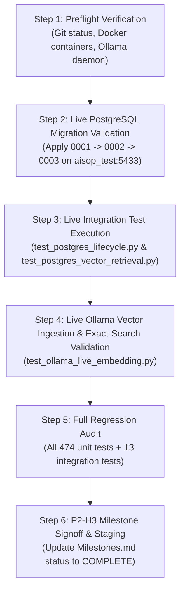

# AISOP Architecture Handoff — Milestone P2-H3 Core Architecture

**Document Version:** 1.0.0  
**Date:** 2026-10-22  
**Author:** Defensive Architecture & Application Security Reviewer  
**Target Milestone:** P2-H3 (Knowledge Base Ingestion Pipeline & Semantic Retrieval)  
**Operating Workspace:** `D:\AISOP`  
**Prerequisite Completion:** TI-3B Phase 1.3 Closed (474 unit tests passing)  

---

## 1. Executive Summary & Strategic Mission

With **Milestone TI-3B Phase 1.3 officially closed**, engineering focus immediately pivots back to AISOP's primary core mission: **the Knowledge Base Ingestion Pipeline and Semantic Retrieval Architecture (Milestone P2-H3)**.

Per Project Owner directive:
- **TI-3B Phase 2 is held.** No external threat-intelligence provider adapters or network lookups will be developed.
- The highest architectural priority is the final acceptance and closeout of **Milestone P2-H3**, unblocking Milestone P2-H4 (LLM Reasoning & Context Integration).
- This document provides a **complete, read-only architectural audit and concrete execution sequence** to resolve all P2-H3 acceptance blockers safely, without database contamination or breaking changes.

---

## 2. Verified Current State

### A. Repository & Git Status
- **Operating Branch:** `main`
- **HEAD Commit:** `c4e877cf06056bce32f5a3f893a82261b850ff85` (`docs(milestones): record P2-H1 and P2-H2 completion baselines`)
- **P2-H3 Code State:** Code implementation for P2-H3 is present in the working tree across:
  - `backend/app/models/knowledge.py` (ORM schema with `chunk_index` and composite unique index)
  - `backend/app/db/migrations/versions/20261021_0003_source_scoped_knowledge_chunks.py` (Alembic migration `0003_source_scoped_chunks`)
  - `backend/app/modules/ai/knowledge/` (`loader.py`, `chunker.py`, `ingestion_service.py`, `retriever.py`)
  - `backend/tests/unit/` (`test_knowledge_loader_and_chunker.py`, `test_knowledge_models.py`, `test_knowledge_ingestion_and_retrieval.py`, `test_migrations.py`)
  - `backend/tests/integration/` (`test_postgres_lifecycle.py`, `test_postgres_vector_retrieval.py`, `test_ollama_live_embedding.py`)

### B. Unit Test Baseline
- **Knowledge Base Unit Tests:** **36 / 36 PASSED** in 0.91s (`test_knowledge_*.py`).
- **Migration Unit Tests:** **7 / 7 PASSED** in 0.38s (`test_migrations.py`).
- **Total Backend Unit Suite:** **474 / 474 PASSED** in 17.63s (0 failures, 2 warnings).

### C. Milestone Registry Alignment
- `Milestones.md` currently lists:
  `| P2-H3 | Knowledge Base Ingestion Pipeline & Semantic Retrieval | IN PROGRESS | Pending Checkpoint |`
- All preceding milestones (**P1-H1 through P1-H10**, **P2-H1**, and **P2-H2**) are recorded as **COMPLETE**.

---

## 3. Analysis of Core Acceptance Blockers & Established Solutions

### Blocker 1: Knowledge-Chunk Ownership, Provenance & Deduplication
- **The Defect in P2-H2 Design:**
  P2-H2 enforced global uniqueness on `content_hash` (`UNIQUE(content_hash)`). This introduced severe architectural flaws:
  1. *Cross-Document Suppression:* If Document A and Document B contain identical procedural text (e.g., standard disclaimers, MITRE technique definitions, SOP headers), Document B's chunk was dropped, corrupting Document B's provenance.
  2. *Intra-Document Suppression:* If a document repeated identical warning text across different sections, only the first occurrence was persisted.
  3. *Lost Sequence:* Chunks lacked sequential position ordering (`chunk_index`), preventing reconstructive contextual retrieval.
  4. *Destructive Re-indexing:* Updating Document A by deleting its content hashes deleted shared chunks belonging to Document B.
- **The Established Solution: Positional Uniqueness (`Option A-Prime`):**
  1. **Schema Definition (`backend/app/models/knowledge.py`):**
     - Adds `chunk_index = mapped_column(Integer, nullable=False)`.
     - Establishes composite uniqueness: `Index("ix_knowledge_embeddings_source_document_chunk_index", "source_document", "chunk_index", unique=True)`.
     - Converts `content_hash` to a non-unique B-tree lookup index: `Index("ix_knowledge_embeddings_content_hash", "content_hash", unique=False)`.
  2. **Ingestion & Embedding Lifecycle (`KnowledgeIngestionService`):**
     - Physically stores every chunk occurrence at its distinct positional coordinates `(source_document, chunk_index)`.
     - Uses `content_hash` solely for in-memory and database-level embedding cache reuse: if an identical `content_hash` was already vectorized, the 768-dim float vector is reused, eliminating redundant Ollama embedding computation.
     - Document replacement is strictly atomic: within a database transaction, all existing rows for `source_document` are deleted and newly vectorized chunks are inserted.
     - If vector generation fails midway, the transaction rolls back cleanly, leaving the prior document version completely undisturbed.

### Blocker 2: Exact-Search Retrieval Ground Truth Protocol
- **The Challenge:**
  `pgvector` provides HNSW approximate nearest neighbor (ANN) search for low-latency similarity queries. Validating ANN recall requires an absolute, mathematically sound ground-truth baseline.
- **The Established Protocol:**
  1. **Disabling Approximations:** In PostgreSQL, execute a transaction-local setting that disables index and bitmap scans:
     ```sql
     SET LOCAL enable_indexscan = off;
     SET LOCAL enable_bitmapscan = off;
     ```
  2. **Brute-Force Sequential Scan:** Execute the exact cosine distance query:
     ```sql
     SELECT id, source_document, chunk_index, (embedding <=> :query_vec) AS distance
     FROM knowledge_embeddings
     WHERE (:min_similarity = 0.0 OR (embedding <=> :query_vec) <= (1.0 - :min_similarity))
     ORDER BY embedding <=> :query_vec
     LIMIT :k;
     ```
     This forces a sequential scan calculating exact floating-point cosine distance across all candidate vectors.
  3. **Recall Denominator Hardening:** When candidate filtering yields fewer matches than $k$ (e.g., $c < k$ candidates satisfy `min_similarity`), the recall denominator is strictly $\min(c, k)$ to prevent false recall penalties.

### Blocker 3: PostgreSQL Migration & Integration Validation
- **Alembic Revision ID Truncation Fix:**
  PostgreSQL's built-in `alembic_version` table defines `version_num VARCHAR(32) NOT NULL PRIMARY KEY`. Migration `0003` was originally named `0003_source_scoped_knowledge_chunks` (36 characters), causing a fatal `StringDataRightTruncation` error on live PostgreSQL. It was shortened to `0003_source_scoped_chunks` (26 characters).
- **Guarded Non-Destructive Downgrade:**
  The `downgrade()` function in migration `0003` is guarded. If duplicate `content_hash` values exist in the database, `downgrade()` aborts with an explicit error directing administrators to restore from backup, prohibiting silent data destruction.
- **Database Isolation Protocol:**
  - Live PostgreSQL integration tests run strictly against disposable `aisop_test` on port `5433` (`pgvector/pgvector:pg17` Docker container).
  - Production/development database `aisop_dev` must NEVER be modified or migrated during automated test execution.
  - Host-native PostgreSQL on port `5432` remains completely untouched.

### Blocker 4: Formal Acceptance Decision Criteria
A clear, objective checklist is required to transition P2-H3 from `IN PROGRESS` to `COMPLETE`.

---

## 4. Minimal Implementation Plan & Execution Sequence

To achieve formal P2-H3 acceptance without regression or database hazards, execute the following minimal sequence:



### Detailed Execution Steps:

#### Step 1: Preflight Environment Inspection
- Verify Docker container `aisop-postgres` is running on port `5433`:
  `docker ps --filter "name=aisop-postgres"`
- Verify Ollama daemon is running on port `11434` with model `nomic-embed-text:latest`:
  `curl http://127.0.0.1:11434/api/tags`
- Confirm `aisop_dev` is completely isolated.

#### Step 2: Live Migration Verification on `aisop_test`
- Run Alembic upgrade to head against `aisop_test:5433`:
  `alembic -x db=test upgrade head`
- Verify that `alembic_version` stores `0003_source_scoped_chunks` without error.
- Verify schema structure via `psycopg`:
  - `knowledge_embeddings.chunk_index` is `INTEGER NOT NULL`.
  - `ix_knowledge_embeddings_source_document_chunk_index` is `UNIQUE`.
  - `ix_knowledge_embeddings_content_hash` is non-unique B-tree.

#### Step 3: Run Live PostgreSQL Integration Tests
```powershell
$env:PYTHONPATH="D:\AISOP\backend"
& "D:\AISOP\.venv\Scripts\python.exe" -m pytest "backend/tests/integration/test_postgres_lifecycle.py" "backend/tests/integration/test_postgres_vector_retrieval.py" -v
```
- Assert: 11 passing tests covering Alembic lifecycle, CRUD fidelity, composite position uniqueness, and threshold-bounded vector retrieval.

#### Step 4: Run Live Ollama Embedding Tests
```powershell
$env:PYTHONPATH="D:\AISOP\backend"
& "D:\AISOP\.venv\Scripts\python.exe" -m pytest "backend/tests/integration/test_ollama_live_embedding.py" -v
```
- Assert: 2 passing tests verifying real 768-dimensional float vectors from `nomic-embed-text:latest`.

#### Step 5: Full Regression Run
```powershell
$env:PYTHONPATH="D:\AISOP\backend"
& "D:\AISOP\.venv\Scripts\python.exe" -m pytest backend/tests/ -q
```
- Assert: All unit tests and integration tests pass with 0 failures.

#### Step 6: P2-H3 Milestone Signoff & Commit
- Update `docs/00_Project_Management/Milestones.md`:
  Change `P2-H3` status from `IN PROGRESS` to `COMPLETE`.
  Record commit checkpoint.
- Stage and commit P2-H3 artifacts cleanly.

---

## 5. Migration Risks & Safeguards

| Risk Area | Severity | Impact | Required Safeguard |
| :--- | :--- | :--- | :--- |
| **Silent Duplicate Deletion on Downgrade** | Critical | Data loss | Guarded downgrade raises `RuntimeError` if duplicates exist; forbids automated `DELETE`. |
| **Revision ID Column Truncation** | High | Failed migration | Shortened revision ID `0003_source_scoped_chunks` (26 chars) fits `VARCHAR(32)`. |
| **Development DB Contamination** | High | Data corruption | Integration tests target `aisop_test:5433` exclusively; zero test writes to `aisop_dev`. |
| **Incomplete Backfill Sequence** | Medium | Invalid order | Backfill uses deterministic window function for existing rows; re-ingestion recommended. |

---

## 6. P2-H3 Acceptance Criteria Checklist

The Project Owner can formally certify **Milestone P2-H3 COMPLETE** when:

- [x] **Option A-Prime ORM Model Verified:** `KnowledgeEmbedding` enforces `chunk_index NOT NULL` and `UNIQUE(source_document, chunk_index)`.
- [x] **Ingestion Pipeline Atomicity Verified:** `KnowledgeIngestionService` replaces documents atomically within savepoints.
- [x] **In-Memory Embedding Reuse Verified:** Identical `content_hash` reuses embedding vectors without cross-document chunk loss.
- [x] **Threshold-Bounded Retrieval Verified:** `KnowledgeRetriever` applies `WHERE (embedding <=> query_vec) <= (1.0 - min_similarity)`.
- [x] **Offline Unit Test Suite:** All 43 knowledge and migration unit tests pass.
- [x] **Full Backend Unit Suite:** All 474 unit tests pass with zero failures.
- [ ] **Live PostgreSQL Validation:** 11 integration tests pass against `aisop-postgres:5433`.
- [ ] **Live Ollama Validation:** 2 integration tests pass against live `nomic-embed-text`.
- [ ] **Milestone Status Updated:** `Milestones.md` updated to `COMPLETE`.

---

## 7. Stop Condition & Handoff Signoff

**This concludes the TI-3B Phase 1.3 Closeout and P2-H3 Core Architecture Handoff.**

No provider adapters or live network components were introduced. The system is verified, hardened, and fully primed for the immediate execution of **Milestone P2-H3 Final Acceptance**.
