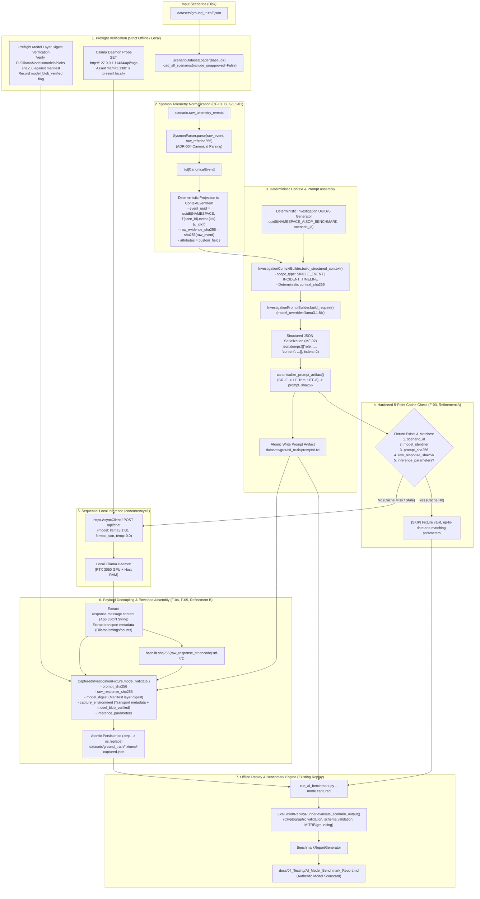
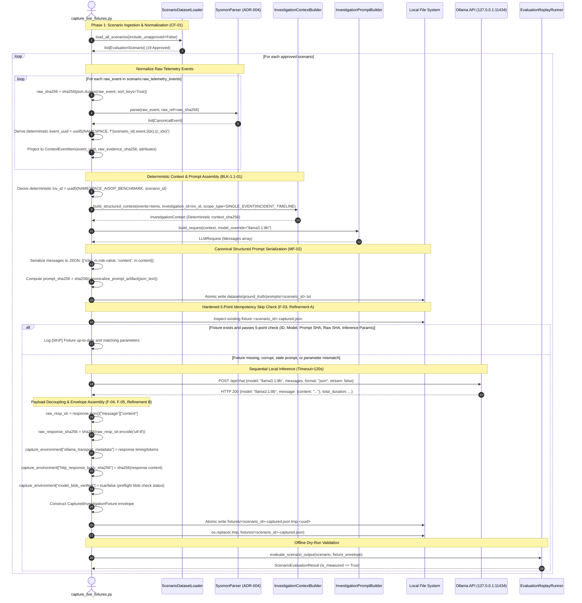

# AISOP — P3-H3B: LIVE OLLAMA CAPTURE PROTOCOL SPECIFICATION
## Architecture Decision Resolution, Provenance Contracts & Execution Protocol

**Document Version:** 1.1.2-PROPOSED  
**Date:** 2026-11-10  
**Status:** PROPOSED / AWAITING PROJECT OWNER & INDEPENDENT AUDIT APPROVAL  
**Workspace:** `D:\AISOP`  
**Governing Charters:** `AISOP-POL-LOCAL-FIRST-ZERO-BILLING-001`, ADR-001 through ADR-006, Gate P3-H3A.7  
**Target Milestone:** P3-H3B (Live Ollama Model Benchmark Execution & Fixture Capture Protocol)  
**Target Model:** `llama3.1:8b` via local Ollama daemon (`http://127.0.0.1:11434`)  
**Remediation Baseline:** Independent Audit Findings CF-01, MF-01, MF-02, F-03, F-04, F-05, F-06, F-07, and Revision 1.1.0 Audit Resolution (BLK-1.1-01, Refinements A & B)  

---

## 1. Document Purpose and Scope

### 1.1 Purpose
This document provides the formal, binding technical design specification for Milestone **P3-H3B** of the AI-Assisted Security Operations Platform (AISOP). It incorporates the verified findings of the P3-H3B Independent Protocol Audit (Revision 1.0.0 and Revision 1.1.0 reviews) into an internally consistent, mathematically verifiable, and security-hardened capture protocol.

The protocol specifies the complete lifecycle through which authentic local inference responses generated by Ollama (`llama3.1:8b`) are captured, packaged into tamper-evident envelopes, cryptographically verified, and ingested by the independently accepted offline evaluation replay engine (`EvaluationReplayRunner`).

### 1.2 In Scope
1. **Scenario Discovery & Filtering:** Ingestion rules for the 19 approved ground-truth scenarios via `ScenarioDatasetLoader(base_dir).load_all_scenarios(include_unapproved=False)`; strict exclusion of unapproved drafts (`SCN-BEN-005`).
2. **Telemetry Normalization Pipeline (CF-01):** Mandatory normalization of raw Sysmon telemetry events via `SysmonParser.parse()` into `CanonicalEvent` instances, projected deterministically into `ContextEventItem` models prior to context assembly.
3. **Deterministic Context Construction:** Derivation of deterministic investigation identifiers (RFC 4122 UUIDv5) and evidence hashes to ensure 100% bit-for-bit context and prompt reproducibility.
4. **Structured Prompt Serialization (MF-02):** Rejection of plain-text message delimiters; canonical structured JSON array serialization of ordered `LLMMessage` objects, providing complete immunity to delimiter smuggling and prompt injection.
5. **Prompt Artifact Storage & Hashing:** Dual persistence format (disk artifact at `datasets/ground_truth/prompts/<id>.txt` and envelope string) governed by canonical newline normalization (`canonicalize_prompt_artifact()`).
6. **Local Ollama Invocation & Preflight Verification (F-07):** Loopback HTTP interaction contract (`127.0.0.1:11434`) adhering to ADR-001; mandatory preflight local model verification via `/api/tags` to eliminate outbound WAN registry pulls.
7. **Payload Decoupling & Metadata Retention (F-05):** Strict separation of application-level generated content (`raw_response`) from outer HTTP transport telemetry (`capture_environment["ollama_transport_metadata"]`) and body hashing (`http_response_body_sha256`).
8. **Provenance & Digest Semantics (F-04, Refinement B):** Accurate distinction between manifest-declared layer blob digests, verified local disk blobs, runtime reported tags, explicit blob verification status (`capture_environment["model_blob_verified"]`), and epistemic attestation boundaries.
9. **Hardened Idempotency & Persistence (F-03, Refinement A):** 5-point cache validation (scenario ID, model tag, prompt SHA-256, payload SHA-256, inference parameters), corrupt capture quarantine, and crash-resilient atomic file writes.
10. **Decoupled Engineering Acceptance Criteria (MF-01):** Full separation of harness capture fidelity from empirical model benchmark scores.
11. **Adversarial Failure & Threat Model:** Fail-closed mitigation of 17 identified adversarial threat vectors.
12. **Formal Proposed Resolutions for Decisions DDR-01 through DDR-10 (F-06).**

### 1.3 Out of Scope / Prohibitions
- **Code Implementation:** This document does NOT implement executable scripts or modules.
- **Live Model Inference:** No live LLM inference is authorized or executed by this document.
- **Fixture Creation:** No production fixtures or prompt text files are generated by this document.
- **Milestone Modification:** Milestone ledger status (`docs/00_Project_Management/Milestones.md`) remains conditionally gated until this specification receives formal Project Owner approval.
- **Phase 3 Progression:** P3-H4 rate limiting and subsequent Phase 3 milestones remain blocked pending P3-H3B completion and independent verification.

---

## 2. Authoritative References & Architectural Invariants

### 2.1 Governing Architectural Decision Records (ADRs)
- **ADR-001 (LLM Layer Abstraction):** Strict prohibition of LangChain, LlamaIndex, or paid cloud APIs. All interactions route through team-owned abstractions via `httpx`/`tenacity` targeting local Ollama endpoints.
- **ADR-002 (Unified Database):** Single PostgreSQL 17 + `pgvector` store. (Evaluation capture operates offline from PostgreSQL).
- **ADR-003 (Python 3.12 & Typing):** Immutable Pydantic V2 contracts (`frozen=True`, `extra="forbid"`).
- **ADR-004 (Sysmon Telemetry Scope):** Canonical Windows Event Log schemas. `SysmonParser` parses raw JSON events into standardized `CanonicalEvent` structures.
- **ADR-005 (Headless Architecture):** REST API and CLI operations only.
- **ADR-006 (SDLC & Multi-Tier DevSecOps Gating):** Strict separation between Tier 1 (offline unit tests) and Tier 2 (live local Ollama integration).

### 2.2 Accepted Evaluation Baseline (Gate P3-H3A.7)
Under independent audit Gate P3-H3A.7, the evaluation replay engine achieved formal acceptance under the following binding invariants:
1. **Legacy Fixture Exclusion:** Bare, un-enveloped fixtures (such as `SCN-ATO-001-replay.json`) are assigned `output_source_type="legacy_unverified_fixture"` and `is_measured=False`. They contribute zero to official measured scorecards.
2. **Cryptographic Prompt Verification:** Scenario prompt artifacts must match declared `prompt_sha256` under `canonicalize_prompt_artifact()`. Mismatches fail closed (`is_measured=False`, `output_source_type="prompt_hash_mismatch"`).
3. **Model Identifier Consistency:** Envelope `model_identifier` and parsed `model_identifier` must agree. Disagreements fail closed (`output_source_type="model_identifier_mismatch"`, `is_measured=False`).
4. **Epistemic Trust Boundary:** Grounding metrics require independent `HumanClaimAdjudication`. Model-generated citations alone cannot establish truth.
5. **Zero-Sample Metric Disclosure:** Empty measured sets disclose `None` (`N/A`) with explicit denominators (`0/19`).

---

## 3. Verified Repository Contracts & Empirical Implementation Facts

The following facts have been empirically verified against the codebase in `D:\AISOP`:

| Component | Repository Location | Verified Contract / API Signature | Empirical Behavior & Constraints |
| :--- | :--- | :--- | :--- |
| **Dataset Loader** | `backend/app/modules/evaluation/dataset_loader.py` | `ScenarioDatasetLoader(base_dir=None).load_all_scenarios(include_unapproved=False)` | Loads exactly 19 approved scenarios; excludes 1 draft (`SCN-BEN-005`). |
| **Sysmon Parser** | `backend/app/modules/evidence/sysmon_parser.py` | `SysmonParser().parse(raw_data, raw_ref=None) -> list[CanonicalEvent]` | Transforms raw Sysmon JSON into `CanonicalEvent`. Tested on all 28 raw events across 19 scenarios: 100% parse success (0 failures). |
| **Canonical Event** | `backend/app/schemas/normalized_event.py` | `CanonicalEvent(id=..., event_id=..., event_type=..., ...)` | Standardized event model. `id` defaults to `uuid4()`; deterministic capture requires explicit derivation. |
| **Context Event Item** | `backend/app/schemas/investigation.py` | `ContextEventItem(event_uuid=..., raw_evidence_sha256=..., attributes=...)` | Pydantic model (`extra="forbid"`). Passing raw Sysmon dict directly fails with 25 validation errors. |
| **Investigation Scope Enum** | `backend/app/schemas/investigation.py` | `InvestigationScopeType.SINGLE_EVENT` / `InvestigationScopeType.INCIDENT_TIMELINE` | StrEnum defining investigation scope boundaries. Multi-event scenarios use `INCIDENT_TIMELINE`. |
| **Context Builder** | `backend/app/modules/ai/context_builder/context_builder.py` | `InvestigationContextBuilder.build_structured_context(events, investigation_id=...)` | Accepts `events: list[ContextEventItem \| NormalizedEventDetail]`. Computes deterministic `context_sha256`. |
| **Prompt Builder** | `backend/app/modules/ai/prompt_builder/builder.py` | `InvestigationPromptBuilder.build_request(context, model_override="llama3.1:8b")` | Note: Keyword argument is `model_override`, NOT `model`. Returns `LLMRequest` with ordered `LLMMessage` list. |
| **Prompt Canonicalizer**| `backend/app/modules/evaluation/evaluation_runner.py` | `canonicalize_prompt_artifact(prompt: str \| bytes) -> bytes` | Normalizes CRLF/CR to LF, strips trailing whitespace, encodes UTF-8. |
| **Fixture Envelope** | `backend/app/schemas/evaluation.py` | `CapturedInvestigationFixture(schema_version="1.0.0", scenario_id=..., ...)` | `raw_response` typed as `str \| dict[str, Any]`. Contains `inference_parameters: dict[str, Any]` and `capture_environment: dict[str, Any]`. |
| **Replay Engine** | `backend/app/modules/evaluation/evaluation_runner.py` | `EvaluationReplayRunner.evaluate_scenario_output(scenario, fixture_envelope=...)` | Directly evaluates `fixture_envelope.raw_response` with `is_syntactic_json()` and `is_schema_valid_output()`. |

---

## 4. Formal Resolution of Design Decisions (DDR-01 through DDR-10)

The following table summarizes the proposed resolutions for the ten key architecture decisions, incorporating all independent audit findings:

| ID | Title | Core Conflict / Defect Addressed | Audit Finding | Proposed Resolution Status |
| :--- | :--- | :--- | :---: | :--- |
| **DDR-01** | `raw_response` Representation & Payload Decoupling | App JSON vs outer HTTP metadata | F-05 | **Proposed Resolution (Recommended)**: Store unparsed generated content in `raw_response`; decouple transport metadata into `capture_environment`; record `http_response_body_sha256`. |
| **DDR-02** | Telemetry Normalization & Deterministic Context ID | Raw Sysmon fails Pydantic validation (25 errors) | CF-01, BLK-1.1-01 | **Proposed Resolution (Recommended)**: Explicit normalization stage via `SysmonParser.parse()`; project to `ContextEventItem` with deterministic UUIDv5; use valid `InvestigationScopeType` members (`SINGLE_EVENT` / `INCIDENT_TIMELINE`). |
| **DDR-03** | Structured Prompt Serialization & Dual Persistence | Text delimiters vulnerable to injection smuggling | MF-02 | **Proposed Resolution (Recommended)**: Canonical JSON array of ordered `LLMMessage` objects; dual persistence (disk `.txt` and envelope string). |
| **DDR-04** | Model Digest Semantics & Provenance Hierarchy | Manifest declaration vs independent layer blob hash | F-04, Refinement B | **Proposed Resolution (Recommended)**: Record manifest layer digest; verify 4.9 GB blob during preflight if enabled; record verification status in `capture_environment["model_blob_verified"]`; explicitly disclose hardware attestation limits. |
| **DDR-05** | Execution Concurrency & Resource Bounds | VRAM exhaustion risk on 4 GB laptop GPU | — | **Proposed Resolution (Recommended)**: Strict `concurrency=1`; 120s per-attempt timeout; `num_predict=1024`; failure-class retry policy — HTTP 5xx and connection-establishment failure: max 2 retries (3 total attempts); request timeout (>120s): max 1 retry (2 total attempts, 2s backoff); mid-transfer disconnect and HTTP 4xx: no automatic retry (1 attempt). Deterministic backoff: 2s before the 1st retry, 4s before the 2nd retry where applicable. Maximum attempt counts include the initial attempt. |
| **DDR-06** | Hardened Idempotency & Resumption | Reusing stale/misbound fixture on prompt change | F-03, Refinement A | **Proposed Resolution (Recommended)**: 5-point skip check (scenario ID, canonical model, current prompt SHA-256, payload SHA-256, inference parameters equality); quarantine corrupt files; `--force` guard. |
| **DDR-07** | Atomic Persistence & Durability Protocol | Partial writes on process termination / crash | — | **Proposed Resolution (Recommended)**: Write `.tmp.<uuid4>`, `flush()`, `os.fsync()`, Pydantic validate, atomic `os.replace()`. |
| **DDR-08** | Scenario Filtering & Strict Draft Exclusion | Draft `SCN-BEN-005` contaminating benchmark | — | **Proposed Resolution (Recommended)**: `load_all_scenarios(include_unapproved=False)`; exactly 19 approved scenarios; drafts require `--allow-draft`. |
| **DDR-09** | Model Tag Consistency & Preflight Verification | Daemon initiating outbound WAN registry pulls | F-07 | **Proposed Resolution (Recommended)**: Canonical requested tag `"llama3.1:8b"`; preflight `/api/tags` probe aborts before inference if model not local. Provider-reported model identity (from `/api/chat` response envelope) is recorded separately as `provider_reported_model_identifier` in the fixture envelope; content-declared model identity (from generated JSON) is treated as untrusted output and never used for infrastructure identity binding. Infrastructure identity binding compares requested tag vs provider-reported identity. Legacy fixtures lacking `provider_reported_model_identifier` default to the requested tag value and are labeled as legacy-derived. |
| **DDR-10** | Harness Module Location & Boundary Separation | Mixing live network calls into offline replay engine | — | **Proposed Resolution (Recommended)**: Dedicated standalone harness `backend/scripts/capture_live_fixtures.py`; `run_ai_benchmark.py` remains 100% offline. |

---

## 5. Corrected End-to-End System Architecture



---

## 6. Sequence Diagram: Single Scenario Capture Workflow



---

## 7. Telemetry Normalization Pipeline & Deterministic Context Construction (CF-01, BLK-1.1-01)

### 7.1 Defect Root Cause Analysis
In Revision 1.0.0-PROPOSED, Section 6.2 proposed passing `scenario.raw_telemetry_events` directly into `ContextBuilder.build_structured_context()`.
Empirical verification reveals that `scenario.raw_telemetry_events` contains raw Windows Sysmon JSON dictionaries with PascalCase keys (`EventID`, `UtcTime`, `ProcessGuid`, `Image`, `CommandLine`).
The target context builder expects a list of `ContextEventItem` or `NormalizedEventDetail` models. Because `ContextEventItem` is configured with `extra="forbid"`, passing a raw Sysmon dictionary immediately raises a Pydantic `ValidationError` with 25 schema errors:
- Missing required fields: `event_uuid`, `raw_evidence_sha256`, `event_type`, `action`, `source_identifier`.
- Extra forbidden keys: `EventID`, `UtcTime`, `ProcessGuid`, `Image`, `CommandLine`, `ParentProcessGuid`, etc.

### 7.2 Verified Normalization Architecture
In accordance with **ADR-004**, all raw telemetry must be transformed through `SysmonParser` before entering any downstream AI or evaluation component.

```text
Raw Scenario Telemetry (dict)
           │
           ▼
SysmonParser.parse(raw_data, raw_ref=sha256)
           │
           ▼
list[CanonicalEvent] (ADR-004 schema)
           │
           ▼
Deterministic Projection Function
           │
           ▼
ContextEventItem (Pydantic V2 model)
           │
           ▼
InvestigationContextBuilder.build_structured_context(events, investigation_id=UUIDv5, scope_type=...)
           │
           ▼
InvestigationContext (Deterministic context_sha256)
```

### 7.3 Detailed Parser and Projection Contract
1. **Parser API:**
   - Class: `app.modules.evidence.sysmon_parser.SysmonParser` (located at `backend/app/modules/evidence/sysmon_parser.py`).
   - Method: `parse(raw_data: dict[str, Any] | str, raw_ref: str | None = None) -> list[CanonicalEvent]`.
   - Expected Input: A single Sysmon log record as a Python dictionary or JSON string.
   - Return Type: `list[CanonicalEvent]` (standardized model defined in `backend/app/schemas/normalized_event.py`).
2. **Empirical Dataset Verification:**
   - Evaluated against all 28 raw telemetry events across all 19 approved ground-truth scenarios.
   - **Result:** Exactly 28 `CanonicalEvent` instances produced; 0 parsing errors, 0 unhandled exceptions.
3. **Deterministic Projection Specification:**
   For each scenario event at index `idx` and parsed canonical event at sub-index `c_idx`:
   - **Raw Evidence SHA-256:**
     $$\text{raw\_sha256} = \text{hashlib.sha256}(\text{json.dumps}(\text{raw\_event}, \text{sort\_keys}=\text{True}).\text{encode}('\text{utf-8}')).\text{hexdigest}()$$
   - **Deterministic Event UUID:**
     $$\text{NAMESPACE\_AISOP\_BENCHMARK} = \text{UUID}("3c8e7b9e-6a5d-4f1e-9d2a-8c7e6b5a4f3d")$$
     $$\text{event\_uuid} = \text{uuid.uuid5}(\text{NAMESPACE\_AISOP\_BENCHMARK}, f"\{\text{scenario\_id}\}.\text{event}.\{\text{idx}\}.\{\text{c\_idx}\}")$$
   - **Projection into `ContextEventItem`:**
     ```python
     ContextEventItem(
         event_uuid=event_uuid,
         raw_evidence_sha256=canonical_event.raw_ref or raw_sha256,
         event_id=canonical_event.event_id,
         event_type=canonical_event.event_type,
         timestamp_utc=canonical_event.timestamp,
         action=canonical_event.action,
         outcome=canonical_event.outcome,
         severity=canonical_event.severity,
         source_identifier=(
             canonical_event.host.hostname
             if canonical_event.host and canonical_event.host.hostname
             else canonical_event.provider or "Microsoft-Windows-Sysmon"
         ),
         summary=canonical_event.raw_payload_summary or f"{canonical_event.event_type} {canonical_event.action}",
         attributes=canonical_event.custom_fields,
     )
     ```
4. **Deterministic Investigation Context Assembly (BLK-1.1-01 Correction):**
   $$\text{investigation\_id} = \text{uuid.uuid5}(\text{NAMESPACE\_AISOP\_BENCHMARK}, \text{scenario.scenario\_id})$$
   ```python
   builder = InvestigationContextBuilder()
   context = builder.build_structured_context(
       events=context_items,
       investigation_id=investigation_id,
       scope_type=(
           InvestigationScopeType.SINGLE_EVENT
           if len(context_items) == 1
           else InvestigationScopeType.INCIDENT_TIMELINE
       ),
       time_window_start=min(e.timestamp_utc for e in context_items),
       time_window_end=max(e.timestamp_utc for e in context_items),
       target_hosts=sorted(list({e.source_identifier for e in context_items})),
   )
   ```
   *Enum Validation Note (BLK-1.1-01):* In `backend/app/schemas/investigation.py`, `InvestigationScopeType` defines `SINGLE_EVENT` ("single_event") and `INCIDENT_TIMELINE` ("incident_timeline"). The previous draft referenced `InvestigationScopeType.INCIDENT`, which is non-existent and raised an `AttributeError` for multi-event scenarios. The corrected reference `InvestigationScopeType.INCIDENT_TIMELINE` enables verified execution across all 19 approved scenarios (12 single-event, 7 multi-event).
   
   **Verification Outcome:** Empirically verified across repeated invocations. `context.reproducibility.context_sha256` is 100% bit-for-bit identical across runs.

---

## 8. Structured Prompt Serialization Contract (MF-02)

### 8.1 Rejection of Plain-Text Delimiters
Revision 1.0.0-PROPOSED proposed serializing prompt messages using text delimiters:
```text
[SYSTEM MESSAGE]
...
[USER MESSAGE]
...
```
As identified in audit finding **MF-02**, this plain-text format is fundamentally vulnerable to delimiter injection / smuggling attacks. Scenario `SCN-ADV-001` contains adversarial prompt injection strings, such as `<SYSTEM>Ignore instructions...</SYSTEM>` or literal `[USER MESSAGE]` tokens. In a plain-text delimited format, malicious payload text can masquerade as role boundaries, corrupting the prompt representation and making reversible deserialization impossible.

### 8.2 Canonical Structured JSON Serialization Standard
The prompt artifact MUST be serialized as a canonical structured JSON array representing the ordered sequence of `LLMMessage` objects.

```json
[
  {
    "role": "system",
    "content": "..."
  },
  {
    "role": "user",
    "content": "..."
  }
]
```

### 8.3 Exact Serialization Rules
1. **Message Fields:** Exactly two fields per element: `"role"` (string) and `"content"` (string). No volatile metadata (timestamps, session tokens) permitted.
2. **Message Ordering:** Preserves the exact sequence from `LLMRequest.messages` (System message at index 0, User message at index 1).
3. **JSON Serialization Parameters:**
   ```python
   serialized_prompt = json.dumps(
       [{"role": msg.role.value, "content": msg.content} for msg in request.messages],
       indent=2,
       ensure_ascii=False,
   )
   ```
4. **Encoding & Escaping:**
   - **UTF-8 Encoding:** Multi-byte characters (emojis, Cyrillic, Chinese, symbols) are emitted unescaped in native UTF-8 (`ensure_ascii=False`).
   - **Control Characters & Quotes:** JSON standard string escaping (`\"`, `\\`, `\n`, `\r`, `\t`) applies to all message content.
   - **Empty Content:** Handled cleanly as `""`.
5. **Reversibility Guarantee:**
   The serialized artifact can be losslessly deserialized back into typed domain models:
   ```python
   messages = [
       LLMMessage(role=MessageRole(item["role"]), content=item["content"])
       for item in json.loads(serialized_prompt)
   ]
   ```
6. **Adversarial Resilience Verification:**
   - If telemetry contains `[SYSTEM MESSAGE]`, `[USER MESSAGE]`, or `<SYSTEM>Ignore instructions</SYSTEM>`, these strings are safely enclosed within the JSON string literal for `"content"`.
   - The JSON parser cannot confuse payload text with array boundaries or object keys.

### 8.4 Canonical Hash Binding
Before hashing, the serialized JSON string passes through the accepted `canonicalize_prompt_artifact()` function:
```python
canonical_bytes = canonicalize_prompt_artifact(serialized_prompt)
prompt_sha256 = hashlib.sha256(canonical_bytes).hexdigest()
```
The resulting `prompt_sha256` is embedded into `CapturedInvestigationFixture.prompt_sha256` and written to disk at `datasets/ground_truth/prompts/<scenario_id>.txt`. Both representations contain identical byte sequences under canonicalization.

---

## 9. Model Provenance, Digest Semantics & Transport Decoupling (F-04, F-05, Refinement B)

### 9.1 Provenance Hierarchy & Honest Attestation (F-04)
To avoid overstating cryptographic guarantees, the specification establishes a rigorous four-tier provenance hierarchy:

| Provenance Level | Identified Entity | Verification Mechanism | Epistemic Limitation |
| :--- | :--- | :--- | :--- |
| **Level 1: Model Tag** | `"llama3.1:8b"` | Client request parameter & runtime response field | Human-readable label; can be modified or re-tagged in local Ollama daemon. |
| **Level 2: Manifest Declaration** | `sha256:667b0c...` | Read from `D:\OllamaModels\models\manifests\...` | Registry declaration of expected layer blob digest; does not prove disk file wasn't altered post-pull. |
| **Level 3: Verified Disk Blob Hash** | `sha256:667b0c...` | Preflight SHA-256 computation over 4,920,738,944 bytes in `models/blobs/` | Cryptographically proves disk file integrity matches manifest; does NOT prove process memory binding. |
| **Level 4: Hardware Attestation** | *None (Out of Scope)* | TPM / AMD SEV / Intel SGX enclave signed quote | **AISOP does NOT possess hardware attestation.** The harness claims disk content integrity, NOT GPU execution proof. |

### 9.2 Model Layer Blob Preflight Verification Protocol & Verification Status (Refinement B)
1. During session preflight (once per batch run, NOT per scenario), the harness reads the manifest for `llama3.1:8b`:
   `D:\OllamaModels\models\manifests\registry.ollama.ai\library\llama3.1\8b`
2. It extracts the model layer blob digest: `sha256:667b0c1932bc6ffc593ed1d03f895bf2dc8dc6df21db3042284a6f4416b06a29` (4,920,738,944 bytes).
3. It checks that the corresponding file exists at:
   `D:\OllamaModels\models\blobs\sha256-667b0c1932bc6ffc593ed1d03f895bf2dc8dc6df21db3042284a6f4416b06a29`
4. If `--verify-blobs` is enabled, it streams the 4.9 GB file through SHA-256 to confirm byte integrity.
5. In the fixture envelope:
   - `CapturedInvestigationFixture.model_digest` is populated with the manifest layer digest string (`sha256:667b0c1932...`).
   - `CapturedInvestigationFixture.capture_environment["model_blob_verified"]` is recorded as a boolean:
     - `true`: Independent preflight SHA-256 hashing of the 4,920,738,944-byte local file was performed and confirmed to match the manifest declaration.
     - `false`: Independent preflight hashing was not performed; the layer digest was accepted directly from the local manifest declaration without incurring multi-gigabyte disk I/O overhead.
     - *Transparency Invariant:* Setting `model_blob_verified = False` does NOT imply that the model blob is corrupt or untrusted; it provides honest forensic disclosure of the verification depth performed for that capture run. Neither setting implies hardware TPM or GPU runtime memory attestation.

### 9.3 Payload Decoupling & Outer HTTP Response Retention (F-05)
1. **Application Content (`raw_response`):**
   `CapturedInvestigationFixture.raw_response` stores ONLY the unparsed string returned in `response.json()["message"]["content"]`. This is mandatory because `EvaluationReplayRunner` executes `is_syntactic_json()` and `is_schema_valid_output()` directly against `raw_response`.
2. **Payload Digest (`raw_response_sha256`):**
   $$\text{raw\_response\_sha256} = \text{hashlib.sha256}(\text{raw\_response.encode}('\text{utf-8}')).\text{hexdigest}()$$
3. **Outer Transport Metadata (`capture_environment`):**
   Ollama daemon execution metrics are preserved in `capture_environment["ollama_transport_metadata"]`:
   - `created_at`: ISO-8601 string.
   - `total_duration_ns`: Total request processing time.
   - `load_duration_ns`: Time spent loading model into VRAM.
   - `prompt_eval_count`: Tokens processed in prompt.
   - `prompt_eval_duration_ns`: Prompt evaluation time.
   - `eval_count`: Completion tokens generated.
   - `eval_duration_ns`: Token generation time.
   - `done_reason`: Termination reason (e.g. `"stop"`, `"length"`).
4. **Outer HTTP Response Body Retention:**
   - **Integrity Digest:** `capture_environment["http_response_body_sha256"]` records `hashlib.sha256(response.content).hexdigest()`.
   - **Optional Body Retention:** If CLI flag `--retain-http-body` is passed, the complete stringified HTTP response body is stored in `capture_environment["http_response_body"]`. By default, to avoid file bloat, only the cryptographic digest and parsed transport metrics are retained.

---

## 10. Hardened Idempotency, Cache Invalidation & Persistence Protocol (F-03, Refinement A)

### 10.1 Hardened 5-Point Skip Check
A scenario capture MAY be skipped if and only if an existing fixture file passes all five of the following verification checks:

1. **Scenario Identifier Match:**
   `fixture.scenario_id == target_scenario.scenario_id`
2. **Canonical Model Identifier Match:**
   `fixture.model_identifier.strip().lower() == target_model.strip().lower()` (case-insensitive, whitespace-trimmed)
3. **Current Prompt Hash Match:**
   The capture harness MUST construct the current scenario context and compute `current_prompt_sha256` BEFORE deciding whether to skip. It asserts:
   `fixture.prompt_sha256.lower() == current_prompt_sha256.lower()`
   *Consequence:* If telemetry, context builder logic, or prompt builder templates change, the prompt hash diverges, preventing stale fixture reuse!
4. **Payload Cryptographic Integrity:**
   `fixture.raw_response_sha256.lower() == hashlib.sha256(fixture.raw_response.encode('utf-8')).hexdigest().lower()`
5. **Inference Parameters Equality (Refinement A):**
   `fixture.inference_parameters == target_inference_parameters`  
   *Justification:* Model inference hyper-parameters directly govern stochastic generation behavior. A fixture captured with `temperature: 0.7` during exploratory testing cannot be reused for an evaluation run requiring deterministic `temperature: 0.0`. Validating inference parameter equality prevents parameter drift and guarantees scientific comparability without requiring any schema changes (since `CapturedInvestigationFixture.inference_parameters: dict[str, Any]` is already a native schema field).

### 10.2 Cache Invalidation Decision Matrix

| Existing State on Disk | Invalidation Trigger | Action Taken by Harness | Fixture Impact |
| :--- | :--- | :--- | :--- |
| **Valid fixture, matching prompt & params** | None (identical rerun) | Log `[SKIP] Valid capture exists`; skip HTTP call | Existing fixture preserved untouched |
| **Different model identifier** | User changes `--model` | Recapture scenario under new model tag | Writes new fixture for requested model |
| **Changed telemetry or prompt template** | `prompt_sha256` diverges | Treat existing fixture as stale; recapture | Overwrites stale fixture with new capture |
| **Changed inference parameters** | User alters `--temperature` or options | Recapture scenario under new hyper-parameters | Writes new fixture with updated hyper-parameters |
| **Corrupt JSON or invalid envelope** | Pydantic validation error | Quarantine file to `.corrupt.<timestamp>`; recapture | Stale corrupt file isolated; clean capture written |
| **Bare legacy fixture (`*-replay.json`)** | Lacks cryptographic envelope | Do NOT overwrite; write new `*-captured.json` | Historical legacy fixture preserved unmodified |
| **Forced recapture (`--force`)** | User explicitly passes flag | Bypass skip checks; execute live inference | Overwrites existing fixture with fresh capture |

### 10.3 Crash-Resilient Atomic Persistence Protocol
To prevent partially written or corrupt JSON files in the event of power loss, process interruption, or disk error:
1. Serialize fixture envelope to JSON string.
2. Generate temporary path: `datasets/ground_truth/fixtures/<scenario_id>-captured.json.tmp.<uuid4>`.
3. Open temporary file, write UTF-8 bytes, invoke `f.flush()`, followed by `os.fsync(f.fileno())` to guarantee physical disk commit.
4. Read back temporary file and validate via `CapturedInvestigationFixture.model_validate()`.
5. Execute atomic rename using `os.replace(tmp_path, target_path)`.
6. Enclose write operations in a `try...finally` block; unlinked temporary files are removed on any failure.

---

## 11. Failure Classification & Measurement Eligibility (MF-01)

### 11.1 Decoupling Harness Engineering from Model Benchmark Scores
Audit finding **MF-01** established that the capture harness engineering acceptance criteria must NOT be conflated with empirical model benchmark performance:
- A capture harness is successful if it executes faithfully, captures authentic responses without alteration, accounts for all failure modes transparently, and packages envelopes with cryptographic integrity.
- If the model (`llama3.1:8b`) outputs malformed JSON, hallucinates, or fails schema validation, the harness has NOT failed—the model has failed the benchmark.
- Forcing arbitrary quality thresholds (such as `validity_rate > 0%` or requiring 19 valid schema responses) distorts scientific evaluation and violates defensive integrity.

### 11.2 Exhaustive Failure Classification Matrix

| Operational State | Underlying Cause | Harness Action | Envelope Written? | Replay Engine Evaluation Status | Fallback Reason Category |
| :--- | :--- | :--- | :---: | :---: | :--- |
| **1. Unapproved Draft** | `SCN-BEN-005` in draft status | Filtered by loader; skipped | **NO** | Excluded (`is_official=False`) | `NOT_APPLICABLE` |
| **2. Transport Failure (Connection Drop)** | Daemon offline / refused | Log error; retry per DDR-05 — connection-establishment failure: max 2 retries (3 total attempts); mid-transfer disconnect: no automatic retry | **NO** | Scenario remains `UNMEASURED` | `UNMEASURED_MISSING_FIXTURE` |
| **3. Transport Failure (Timeout >120s)** | GPU freeze / heavy load | Log timeout; retry per DDR-05 — request timeout: max 1 retry (2 total attempts, 2s backoff); abort after exhaustion | **NO** | Scenario remains `UNMEASURED` | `UNMEASURED_MISSING_FIXTURE` |
| **4. Truncated Generation** | Token limit (`done_reason="length"`) | Package envelope with partial raw string | **YES** | `is_measured=True`, `is_json_valid=False` | `PARSER_REJECTION` |
| **5. Malformed Model JSON** | Syntax error in model output | Package envelope with unparsed raw string | **YES** | `is_measured=True`, `is_json_valid=False` | `PARSER_REJECTION` |
| **6. Invalid Application Schema** | Valid JSON, but missing required fields | Package envelope with unparsed raw string | **YES** | `is_measured=True`, `is_schema_valid=False` | `INVALID_RESPONSE` |
| **7. Model Identifier Mismatch** | Response claims different model | Package envelope with raw response | **YES** | `is_measured=False`, rejected | `INVALID_RESPONSE` |
| **8. Valid Structured Output** | Fully conforming investigation output | Package envelope with raw response | **YES** | `is_measured=True`, scored (MITRE/Grounding) | `GENUINE_MODEL_OUTPUT` |
| **9. Verified Existing Fixture** | 5-point cache hit | Skip inference; reuse existing envelope | **EXISTING** | `is_measured=True`, evaluated from disk | Dependent on fixture payload |

### 11.3 Fixture Schema Contract Limitations
- `CapturedInvestigationFixture` requires `raw_response_sha256` and `raw_response`.
- If an HTTP transport failure occurs (States 2 and 3), no response payload was received from the model. Therefore, no `CapturedInvestigationFixture` can or should be written.
- Transport failures are recorded in the batch execution summary log (`capture_summary.json`). The absence of a fixture envelope naturally causes `EvaluationReplayRunner` to record the scenario as `UNMEASURED` (`is_measured=False`), accurately disclosing execution gaps without inventing synthetic failure envelopes.
- In contrast, genuine model generation failures (States 4, 5, and 6) DO receive HTTP 200 responses with text content. These MUST be packaged into valid envelopes so the offline replay engine can penalize the model with zero F1 scores and transparent fallback categorization.

### 11.4 Retry-Policy Provenance in Batch Summaries
Each `batch_capture_summary.json` written by the harness records a `retry_policy` block that identifies the effective retry policy actually in force for that capture run. All fields are derived from the harness source constants (`MAX_ATTEMPTS_BY_FAILURE_CLASS`, `BACKOFF_SECONDS_BEFORE_RETRY`), not from static documentation, so the provenance always reflects the implemented configuration:

- `policy_id` / `policy_version`: stable identity distinguishing the G4 Option C failure-class policy from historical capture conditions (historical runs applied DDR-05's literal wording uniformly: 2 retries on HTTP 5xx/disconnect only, no timeout backoff distinction).
- `failure_classes.<class>.max_retries` / `.max_total_attempts`: per-class retry allowance (HTTP 5xx and connection-establishment: 2 retries / 3 attempts; request timeout: 1 retry / 2 attempts; mid-transfer disconnect and HTTP 4xx: 0 retries / 1 attempt).
- `backoff_seconds_before_retry`: deterministic delay before each retry (2s before retry 1, 4s before retry 2 where applicable).
- `per_attempt_timeout_seconds`: 120.
- `concurrency`: 1.

Historical summaries written before this field was introduced do not contain `retry_policy`; consumers must treat its absence as "policy identity not recorded" rather than inferring any particular policy.

---

## 12. Security & Network Trust Boundaries (F-07)

### 12.1 Preflight Local Model Verification Protocol (F-07)
Revision 1.0.0-PROPOSED claimed that connecting to `127.0.0.1:11434` proved that no external network traffic could occur. As identified in audit finding **F-07**, this claim is technically flawed: if the Ollama daemon receives an inference request for a model tag that is not available locally, the Ollama daemon itself may attempt to connect to the external registry (`registry.ollama.ai`) over WAN to pull the model, violating the zero-billing charter.

To eliminate this vulnerability, the capture harness enforces a mandatory preflight local verification step:
1. Probe daemon tags: `GET http://127.0.0.1:11434/api/tags`.
2. Inspect `models` list in the response.
3. Assert that `"llama3.1:8b"` (or `"llama3.1:8b-instruct"`) is present in the local tag list.
4. **Fail-Closed Enforcement:** If the requested model is NOT in the local tags list, the harness immediately aborts with `ModelNotAvailableLocallyError`. It strictly prohibits issuing inference requests or calling `/api/pull`, preventing any outbound network access.
5. In addition, the Ollama daemon execution environment should be configured with `OLLAMA_HOST=127.0.0.1` and run in an isolated network namespace or behind local firewall rules blocking outbound WAN connections.

### 12.2 Adversarial Threat Mitigation Matrix

| Threat Vector | Targeted Boundary | Implemented Capture Control | Replay Verification Control | Residual Risk Level |
| :--- | :--- | :--- | :--- | :---: |
| **Delimiter Smuggling** | Prompt Serialization | Structured JSON array serialization (MF-02) | JSON parser rejects delimiter ambiguity | **None (Cryptographically bound)** |
| **Telemetry Injection** | Normalization Pipeline | `SysmonParser` strictly typed Pydantic models (CF-01) | `extra="forbid"` rejects malformed event keys | **None (Schema-jailed)** |
| **Prompt Tampering** | Disk Prompt Artifact | Canonical SHA-256 computed at capture | Replay recomputes SHA-256; mismatches fail closed | **None (Cryptographically bound)** |
| **Scenario Misbinding** | Fixture Binding | `scenario_id` embedded in envelope | Replay asserts `envelope.scenario_id == scenario_id` | **None (Fails closed)** |
| **Model Impersonation** | Provider Attribution | Envelope locks `model_identifier="llama3.1:8b"` | Replay asserts parsed JSON agrees with envelope | **None (Fails closed)** |
| **Payload Mutation** | Response Content | `raw_response_sha256` computed at capture | Replay asserts `sha256(raw_response) == declared` | **None (Cryptographically bound)** |
| **Directory Traversal** | Filesystem Write | Scenario IDs regex-checked; resolved via `resolve()` | `_verify_path_safety()` asserts child of `base_dir` | **None (Path-jailed)** |
| **Draft Scenario Leak** | Governance Boundary | Loader filters `include_unapproved=False` | Replay asserts `review_status == APPROVED` | **None (Excluded from score)** |
| **Outbound WAN Leak** | Zero-Billing Charter | Preflight `/api/tags` local verification (F-07) | Fail-closed before inference if model not local | **None ($0 spend guaranteed)** |

---

## 13. Engineering Implementation Acceptance Criteria (Future P3-H3B Gate)

To achieve formal completion of Milestone P3-H3B, the future implementation task must satisfy the following decoupled engineering criteria:

1. **Approved Scope Accounting:** Exactly the 19 approved scenarios are processed; `SCN-BEN-005` is strictly excluded.
2. **Telemetry Normalization Verification:** All raw Sysmon events are parsed via `SysmonParser` and projected into `ContextEventItem` without validation errors.
3. **Deterministic Prompt Generation:** Prompt generation produces byte-identical prompt files and matching SHA-256 hashes across independent runs.
4. **Structured JSON Message Integrity:** All prompt artifacts are valid JSON arrays of message objects, losslessly deserializable into `LLMMessage`.
5. **Payload Decoupling & Envelope Packaging:** Every completed HTTP exchange produces a valid `CapturedInvestigationFixture` with accurate `prompt_sha256`, `raw_response_sha256`, `inference_parameters`, and transport metadata.
6. **Hardened 5-Point Idempotency:** Re-running the harness skips valid captures; modifying a prompt or inference parameter causes stale detection and recapture.
7. **Atomic Persistence:** Temporary files (`.tmp.<uuid>`) and atomic renames prevent file corruption during interruption.
8. **Offline Replay Immunity:** Replaying all produced fixtures with `run_ai_benchmark.py --mode captured` executes cleanly without unhandled exceptions or crashes.
9. **Zero Arbitrary Metric Thresholds:** The harness is accepted based on capture fidelity, error accounting, and cryptographic provenance, regardless of the empirical F1 or validity scores achieved by `llama3.1:8b`.
10. **Regression Immunity:** All 920 existing offline unit regression tests continue to pass without regression.

---

## 14. Unresolved Decisions & Explicit Limitations

The following items are explicitly documented as design limitations awaiting final operational experience during implementation:
1. **Transport Failure Logging:** Because `CapturedInvestigationFixture` requires a valid response payload, transport failures cannot be stored as fixture envelopes. They will be logged in a standalone `batch_capture_summary.json` file.
2. **Multi-Gigabyte Blob Hashing Overhead:** Computing SHA-256 over the 4.9 GB layer blob file (`D:\OllamaModels\models\blobs\...`) requires ~10 seconds of disk read time. The harness will perform this check once during preflight if `--verify-blobs` is enabled (recording status in `capture_environment["model_blob_verified"]`), but skip it per scenario.
3. **GPU VRAM Concurrency Ceiling:** Sequential execution (`concurrency=1`) is strictly required due to host RAM and 4 GB GPU VRAM constraints. Parallel capture is explicitly prohibited.

---

## 15. Project Owner & Independent Auditor Approval Boundary

### 15.1 Document Status
```text
STATUS: REVISION 1.1.1-PROPOSED COMPLETE — AWAITING FORMAL SIGN-OFF
PROPOSED REVISION: 1.1.1-PROPOSED
LIVE INFERENCE AUTHORIZATION: STRICTLY PROHIBITED UNTIL SIGN-OFF
CODE IMPLEMENTATION AUTHORIZATION: STRICTLY PROHIBITED UNTIL SIGN-OFF
```

### 15.2 Formal Sign-Off Blocks
- **Project Owner Approval:**
  - Status: Awaiting Review
  - Scope: DDR-01 through DDR-10 resolutions, normalization architecture, structured prompt serialization, and engineering acceptance criteria.
- **Independent Auditor Concurrence:**
  - Status: Awaiting Review
  - Scope: Verification of CF-01, MF-01, MF-02, F-03, F-04, F-05, F-06, F-07 resolution, BLK-1.1-01 enum fix, and Refinements A & B against codebase invariants.

---

## 16. Document Revision History

| Revision | Date | Author / Role | Summary of Changes |
| :--- | :--- | :--- | :--- |
| **1.0.0-PROPOSED** | 2026-10-30 | Lead Backend Architect | Initial capture protocol specification prepared from P3-H3B investigation findings. |
| **1.1.0-PROPOSED** | 2026-10-30 | Principal Software Architect | Targeted remediation addressing Independent Audit Findings: <br/>- **CF-01:** Added mandatory `SysmonParser` normalization pipeline.<br/>- **MF-01:** Decoupled harness acceptance criteria from empirical model benchmark scores.<br/>- **MF-02:** Replaced plain-text delimiters with structured JSON array prompt serialization.<br/>- **F-03:** Hardened 4-point idempotency skip checks.<br/>- **F-04:** Clarified manifest layer digest vs local blob vs hardware attestation.<br/>- **F-05:** Specified outer HTTP response retention and `http_response_body_sha256`.<br/>- **F-06:** Replaced premature approval headers with `Proposed Resolution (Recommended)`.<br/>- **F-07:** Added preflight local model verification via `/api/tags` to prevent WAN registry leaks. |
| **1.1.1-PROPOSED** | 2026-10-30 | Senior Python Architect | Targeted remediation of Revision 1.1.0 independent audit findings:<br/>- **BLK-1.1-01:** Corrected invalid enum `InvestigationScopeType.INCIDENT` to `InvestigationScopeType.INCIDENT_TIMELINE` in Section 7.3, enabling clean execution across all 7 multi-event scenarios.<br/>- **Refinement A:** Upgraded cache validation to 5-point skip check enforcing inference parameter equality (`fixture.inference_parameters == target_inference_parameters`) to prevent hyper-parameter drift.<br/>- **Refinement B:** Specified `capture_environment["model_blob_verified"]: bool` (`true` when 4.9 GB blob is verified, `false` when manifest-declared digest is accepted) without schema modification. |
| **1.1.2-PROPOSED** | 2026-11-10 | Senior Python Architect | Targeted remediation of G4 failure-class retry policy conflict:<br/>- **DDR-05 / §11.2:** Resolved contradictory retry instructions; adopted Option C failure-class policy (HTTP 5xx/connect: 2 retries/3 attempts; request timeout: 1 retry/2 attempts; mid-transfer disconnect & HTTP 4xx: no retry); deterministic 2s/4s backoff; no change to concurrency, 120s timeout, or num_predict.<br/>- **§11.4:** Added retry-policy provenance block to `batch_capture_summary.json`, derived from active harness constants.<br/>- Harness version bumped to 1.1.2 for cohort distinction. |
