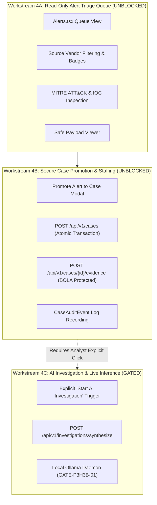

# AISOP — Phase 4 Readiness Assessment & Frontend Sequencing Decision

**Document Version:** 1.0.0  
**Date:** 2026-10-31  
**Status:** FORMAL ARCHITECTURAL EVALUATION  
**Repository:** `D:\AISOP`  
**Current Git HEAD:** `c4e877cf06056bce32f5a3f893a82261b850ff85` on `main`  
**Author:** Principal Full-Stack Engineer, Frontend Design Architect & Application Security Engineer  

---

## 1. Executive Summary & Readiness Verdict

### Can Phase 4 Safely Proceed While Phase 3 Has Gated Work?
**VERDICT: YES, under Option C (Structured Workstream Splitting).**

Phase 4 frontend development can safely proceed **without unblocking or bypassing P3-H3B live model capture**, provided that frontend capabilities are cleanly segregated into:
1. **Independent Workstreams (Safe to build now):** Alert queue visualization, source-neutral alert details, vendor badges, severity filtering, MITRE technique exploration, and secure alert-to-case promotion.
2. **Gated Workstreams (Held at gate):** Autonomous model invocation, live Ollama synthesis, and unverified AI investigation triggers.

---

## 2. Capability-by-Capability Phase 4 Readiness Matrix

| Proposed Frontend Capability | Backend Dependency | Security & Auth Dependency | Can Proceed Now? | Constraints & Operational Boundaries |
|:---|:---|:---|:---:|---|
| **Alert Queue Presentation** | `GET /api/v1/evidence/events` | `verify_api_key`, RBAC Decision 1A (Sanitized projections) | **YES** | Read-only presentation. Adhere to Website Design Constitution (restrained palette, zero emojis/purple gradients). |
| **Alert Adapter Discovery** | `GET /api/v1/alerts/adapters` | `verify_api_key` | **YES** | Read-only schema discovery. Displays supported vendors, severities, and categories. |
| **Heterogeneous Alert Detail View** | `GET /api/v1/evidence/events/{id}` | `can_access_unscoped_event_detail` (Tier-2/Admin) or Case Scoping | **YES** | Safe JSON payload formatting. Text-break formatting on long command lines/paths. No `dangerouslySetInnerHTML`. |
| **Multi-Source Ingestion UI** | `POST /api/v1/alerts/ingest` | `verify_api_key`, `can_ingest_telemetry` | **YES** | Manual or file upload of alert batches. Backend enforces payload ceiling (128 KB) and SHA-256 deduplication. |
| **Alert-to-Case Promotion** | `POST /api/v1/cases`, `POST /api/v1/cases/{id}/evidence` | `has_global_role` (Tier-1+), `get_case_assignment_context` | **YES** | Creates case and links alert atomically. Backend enforces `UniqueConstraint(case_id, evidence_id)` and records audit log. |
| **Evidence Association & Timeline** | `GET /api/v1/cases/{id}/evidence` | `get_case_assignment_context` (Assigned analysts only) | **YES** | Chronological timeline. Explicitly separates observed telemetry from AI inferences. |
| **Report Viewer Integration** | `GET /api/v1/cases/{id}/reports` | `get_case_assignment_context` | **YES** | Already implemented and verified (11 unit tests passing). Displays Executive, Technical, and Detection tabs. |
| **AI Investigation Invocation** | `POST /api/v1/investigations/synthesize` | `can_run_ai_synthesis` (Lead/Investigator) | **GATED / MOCK ONLY** | **STRICTLY GATED.** Must require explicit analyst action (`Start AI Investigation`). Zero autonomous execution. |
| **Live Ollama Streaming / Inference** | Local Ollama Daemon (`/api/chat`) | Local loopback boundary | **GATED** | Blocked under Gate GATE-P3H3B-01 pending explicit Project Owner authorization. |

---

## 3. Evaluation of Frontend Sequencing Options

### Option A: Complete Phase 3 First (Waterfall Gate)
- **Concept:** Halt all Phase 4 frontend engineering until the Project Owner authorizes live Ollama model capture for P3-H3B and P3-H4 is formally signed off.
- **Evaluation:** **REJECTED.**  
  - P3-H3B is an offline benchmark calibration protocol for scoring model accuracy across 19 historical Sysmon scenarios. It has zero architectural coupling to frontend alert triage or case management.
  - Halting frontend work provides zero additional security hardening while causing substantial unnecessary engineering delays.

### Option B: Unrestricted Phase 4 Implementation in Parallel
- **Concept:** Proceed with full frontend implementation, including automated AI investigation triggers and live model connection.
- **Evaluation:** **REJECTED.**  
  - Violates the core human-in-the-loop principle: opening an alert must never automatically trigger expensive or unapproved LLM inference.
  - Risk of accidental outbound network calls or unauthorized local GPU load if live inference components are enabled prematurely.

### Option C: Split Phase 4 into Independent and Gated Workstreams (RECOMMENDED)
- **Concept:** Structure Phase 4 into three decoupled engineering workstreams with distinct acceptance criteria and security boundaries:

- **Technical Justification:**
  - Workstreams 4A and 4B depend exclusively on **P3-H1 (Authentication)**, **P3-H2 (Case Scoping & RBAC)**, and **Phase 4 (Vendor-Neutral Ingestion API)**, all of which are **100% complete, verified by 180+ tests, and active in the repository**.
  - Workstream 4C remains strictly gated behind Gate GATE-P3H3B-01 until the Project Owner authorizes live model execution.
  - This architecture guarantees that SOC analysts can triage multi-source alerts, investigate evidence, manage cases, and view deterministic reports without triggering any live model calls.

---

## 4. Frontend Security & Governance Invariants

All future frontend components must comply with the following non-negotiable rules:

1. **Backend as Sole Authorization Authority:** The frontend must never assume authorization based on client-side state. Access denial from the backend (HTTP 401/404/409/422) must be rendered gracefully with clear error boundaries.
2. **Strict Denial of Anti-Patterns (Design Constitution):**
   - Zero purple-to-blue SaaS gradients.
   - Zero pill buttons (maximum border radius: 6px).
   - Zero emojis (use clean, professional SVG icons).
   - Zero em dashes (`—`) in UI copy.
   - Zero fabricated metrics, fake alerts, or synthetic confidence scores.
3. **Defense Against Content Injection (XSS):**
   - No `dangerouslySetInnerHTML`.
   - String truncation and CSS word-break (`break-all`) on long observables, hashes, and command lines.
4. **Mandatory Human-in-the-Loop Disclaimers:**
   - Every investigation view must display the advisory policy notice: *"AI-assisted outputs are advisory hypotheses for analyst verification. AISOP strictly prohibits autonomous remediation."*

---

## 5. Formal Sequencing Recommendation

1. **Step 1 (Immediate Next Task):** Author and execute **Workstream 4A: Frontend Alert Triage Queue & Adapter Discovery** (`Alerts.tsx`), connecting `GET /api/v1/alerts/adapters` and `GET /api/v1/evidence/events` with source-neutral presentation, vendor badges, severity tags, and responsive filtering.
2. **Step 2:** Author and execute **Workstream 4B: Secure Alert-to-Case Promotion**, wiring the modal to `POST /api/v1/cases` and `POST /api/v1/cases/{case_id}/evidence` under verified RBAC attribution.
3. **Step 3 (Gated):** When the Project Owner authorizes live Ollama execution, proceed to **Workstream 4C** and P3-H3B live benchmark capture.

