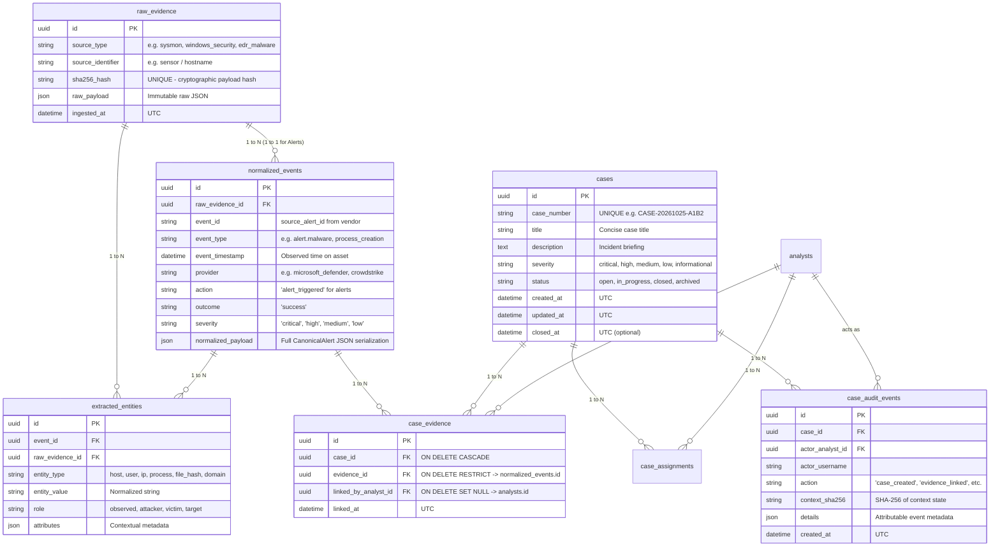

# AISOP — Alert, Case, and Evidence Traceability Architecture

**Document Version:** 1.0.0  
**Date:** 2026-10-31  
**Status:** ARCHITECTURAL SPECIFICATION & TRACEABILITY AUDIT  
**Repository:** `D:\AISOP`  
**Current Git HEAD:** `c4e877cf06056bce32f5a3f893a82261b850ff85` on `main`  
**Author:** Principal Security Architect & Senior Application Security Engineer  

---

## 1. Executive Summary & Purpose

This document formally details the data architecture, entity relationships, and cryptographic traceability of security alerts throughout their operational lifecycle in AISOP:

$$\text{Incoming Alert} \longrightarrow \text{Canonical Alert} \longrightarrow \text{Persisted Evidence} \longrightarrow \text{Case Association} \longrightarrow \text{Investigation} \longrightarrow \text{Report}$$

It clarifies the exact technical boundaries between **Alerts**, **Evidence**, and **Cases** based on the actual PostgreSQL/SQLAlchemy implementation, resolving common ambiguities regarding shared evidence and promotion paths.

---

## 2. Actual Entity-Relationship Architecture

The following diagram represents the **exact schema implemented in code and migrations** ([`app.models.evidence`](file:///D:/AISOP/backend/app/models/evidence.py) and [`app.models.case`](file:///D:/AISOP/backend/app/models/case.py)), not an aspirational model:

---

## 3. Critical Architectural Distinctions

To avoid architectural confusion, AISOP enforces strict definitions across the alert, evidence, and case domains:

### 3.1 Alert $\longrightarrow$ Evidence (Identity Projection)
- **There is no separate `alerts` table.**
- In AISOP, an **Alert IS an Evidence record**.
- Specifically, when `AlertIngestionService.ingest_batch()` processes a `CanonicalAlert`:
  1. It persists the verbatim payload into `raw_evidence`.
  2. It projects the canonical alert into a `NormalizedEventModel` record where:
     - `event_id` = `canonical_alert.source_alert_id`
     - `event_type` = `f"alert.{canonical_alert.category}"`
     - `action` = `"alert_triggered"`
     - `severity` = `canonical_alert.severity`
     - `normalized_payload` = `canonical_alert.model_dump(mode="json")`
- Therefore, the alert's database identity is the UUID of the `NormalizedEventModel` (`normalized_events.id`).

### 3.2 Case $\longrightarrow$ Evidence (Direct M:N Association)
- Cases and normalized evidence are linked via the `case_evidence` junction table.
- A case can link an arbitrary number of evidence records.
- Referential integrity is protected by `ON DELETE RESTRICT` on `evidence_id`, preventing accidental deletion of evidence that is referenced in an active security case.

### 3.3 Case $\longrightarrow$ Alert (Filtered View of Case Evidence)
- A case does not possess a direct `case_alerts` table.
- Alerts associated with a case are simply the subset of `case_evidence` where `NormalizedEventModel.action == 'alert_triggered'` or `event_type LIKE 'alert.%'`.

### 3.4 Alert $\longrightarrow$ Case (Case Association Path)
- An alert is associated with a case by creating a row in `case_evidence` referencing the alert's `NormalizedEventModel.id`.
- The database enforces uniqueness on `(case_id, evidence_id)` via `uq_case_evidence_case_evidence`. Duplicate associations are rejected with `HTTP 409 Conflict`.

---

## 4. Traceability & Integrity Invariants

### 4.1 Upstream Alert Identity & Provenance
Throughout case promotion and subsequent AI investigation synthesis, the following attributes remain immutable:
1. **Source Alert ID:** The upstream vendor's identifier (e.g. CrowdStrike detection ID, Windows event record ID) is preserved in `normalized_events.event_id` and inside `normalized_events.normalized_payload["source_alert_id"]`.
2. **Cryptographic Raw Reference:** The SHA-256 digest of the raw alert payload is computed upon ingestion and preserved in `raw_evidence.sha256_hash` and `normalized_events.normalized_payload["raw_ref"]`.
3. **Vendor-Specific Fields:** All unmapped vendor fields are retained in `normalized_events.normalized_payload["custom_fields"]` and `raw_evidence.raw_payload`.

### 4.2 Multi-Case Sharing vs. Multi-Alert Sharing

> [!IMPORTANT]
> **Key Finding: Sharing Dynamics in the Schema**
> - **Can multiple cases share the same alert? YES.**  
>   Because `case_evidence` is a many-to-many junction table with a composite key `(case_id, evidence_id)`, Alert $A$ can be linked to Case 1 and simultaneously linked to Case 2 without duplicating or altering the underlying alert record.
> - **Can multiple alerts share the same evidence record? NO.**  
>   In `AlertIngestionService`, each unique alert payload produces exactly one `RawEvidence` record and one `NormalizedEventModel` record. If an alert arrives with a duplicate SHA-256 payload, it is dropped as a duplicate. Distinct alerts never point to the same `NormalizedEventModel`.

---

## 5. Identified Architectural Limitations & Smallest Safe Correction

### 5.1 Limitation 1: Alert Triage Status Persistence
- **Observation:** `CanonicalAlert` defines an `AlertStatus` (`new`, `triaged`, `investigating`, `closed`, `suppressed`). However, `NormalizedEventModel` has no column for `status`.
- **Current State:** The status is serialized only inside the JSON blob `normalized_payload["status"]`.
- **Consequence:** Filtering alerts by status (e.g. "show only new alerts") requires querying inside the JSONB payload or scanning all alert rows.
- **Smallest Safe Correction:**  
  In the alert query service, extract `status` from `normalized_payload->>'status'` (or default to `'new'`) during SQL query execution. For future migrations, a dedicated column or indexed virtual column on `normalized_events` can be added if volume requires it.

### 5.2 Limitation 2: Two-Step Case Promotion vs. Atomic Promotion (RESOLVED)
- **Historical State:** `CaseCreateRequest.initial_evidence_ids` was accepted by schema validation, but `CaseService.create_case()` only recorded the count in audit details and failed to insert rows into `CaseEvidenceModel`.
- **Implemented Resolution:** `CaseService.create_case()` now validates all `initial_evidence_ids`, verifies existence, rejects duplicate IDs (HTTP 400), fails closed if any ID is missing (HTTP 404), and atomically inserts `CaseEvidenceModel` associations alongside attributable `evidence_linked` audit records within a single database transaction. This has been verified by 18 unit tests in `test_alert_retrieval.py`.

---

## 6. End-to-End Investigation & Reporting Data Flow

When a case with associated alerts progresses to investigation:
1. **Context Assembly:** `InvestigationContextBuilder` extracts all `CaseEvidenceModel` records for the case.
2. **Alert Projection:** For evidence records where `action == "alert_triggered"`, the builder deserializes `normalized_payload` to reconstitute the `CanonicalAlert`.
3. **Graph & IOC Correlation:** Extracted entities (`ExtractedEntityModel`) from the alerts are assembled into the timeline and queried against `LocalThreatIntelEngine`.
4. **Advisory Synthesis:** The context is rendered into deterministic prompt messages and evaluated by the local LLM (or mock fallback).
5. **Report Generation:** `InvestigationReportBundle` formats Executive Brief, Technical Timeline, and Detection Observables with full cryptographic grounding references back to `raw_ref` and `event_id`.

