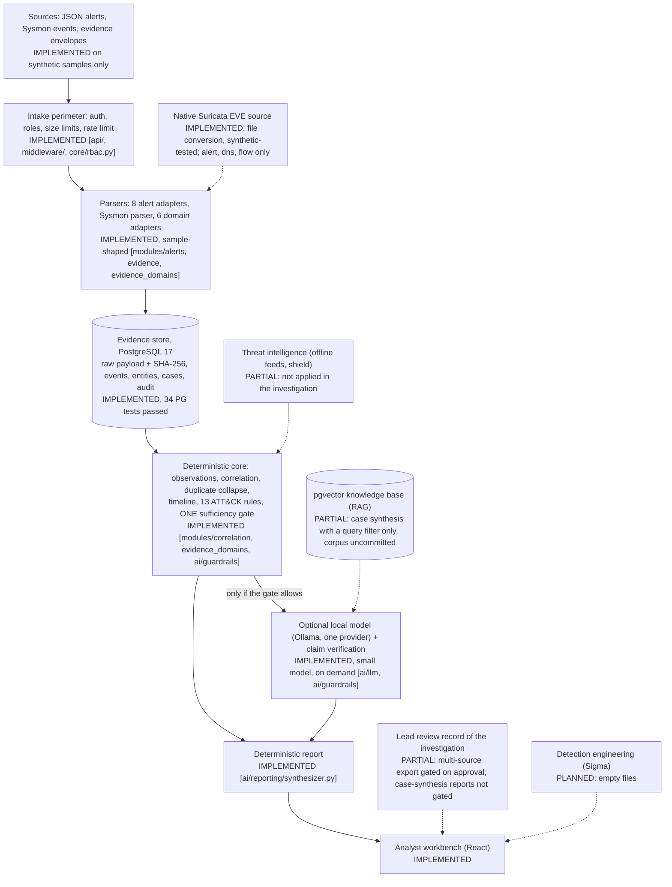
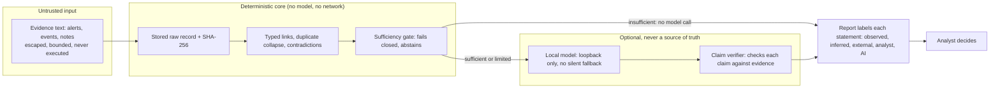
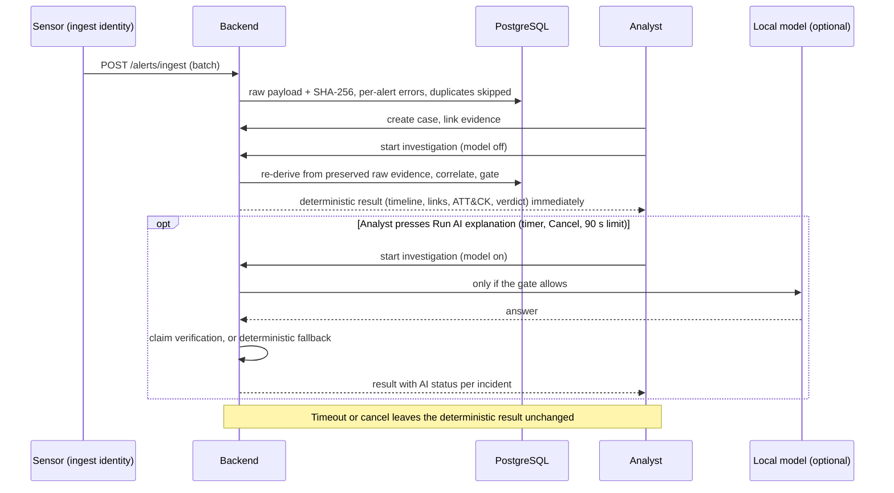

# Architecture Diagrams (drawn from the source, 2026-11-21)

Each component is marked **IMPLEMENTED** (source exists and tests were run), **PARTIAL** (exists but limited or not wired into the path shown) or **PLANNED** (design only). "Implemented" does not mean verified on real data: everything was exercised on synthetic data. Source paths are in brackets.

## 1. Architecture

## 2. Trust boundaries

Rules enforced in code: duplicates count once; analyst notes, threat intelligence and model output never corroborate; missing time stays missing; the model's output is never observed evidence [`correlation/correlator.py`, `evidence/independence.py`, `ai/guardrails/`].

## 3. Investigation sequence

## Gaps these diagrams make visible
Real vendor formats, an approval step, threat-intelligence use in the investigation, RAG in the deterministic path, detection engineering and a native network source are not implemented. They are drawn dashed on purpose.
