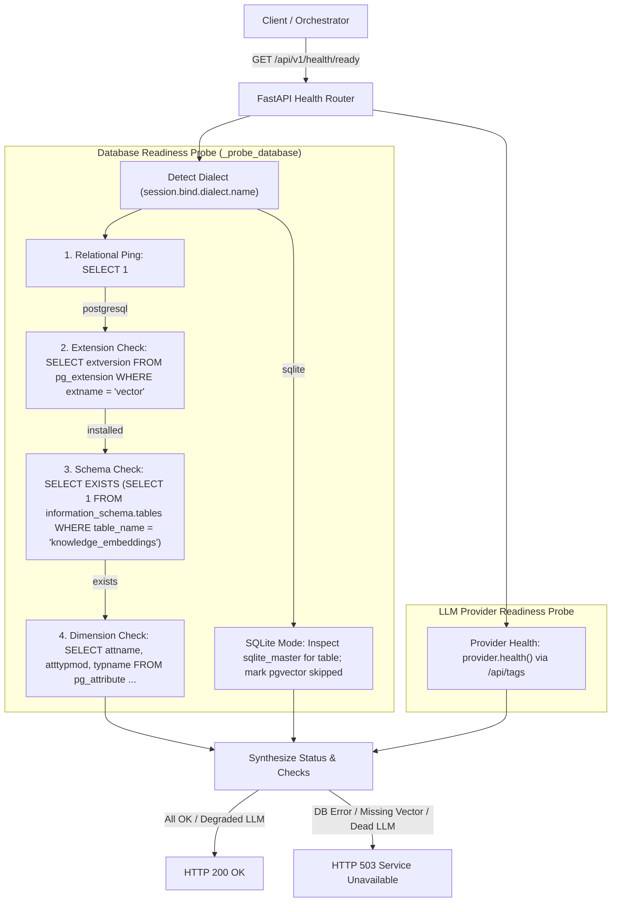

# AISOP Health & Subsystem Readiness Architecture
## Deep PostgreSQL, pgvector & Dependency Verification (REQ-14.1, REQ-14.2, REQ-14.3, REQ-14.4)

- **Target System:** AISOP (AI-Assisted Security Operations Platform)
- **Component:** Health & Readiness Probes (`/api/v1/health` and `/api/v1/health/ready`)
- **Reference Milestones:** P2-H1, P2-H2, P4-GOV, P4-HARDENING-03
- **Primary Governance Requirement:** REQ-14.3 (Deep Database & pgvector Readiness Verification)
- **Status:** **IMPLEMENTED AND VERIFIED**

---

## 1. Executive Summary & Core Principle

> **Engineering Principle:** *A reachable database is not necessarily a ready database.*

In AI-assisted defensive security workbenches, verifying a raw TCP connection or a trivial `SELECT 1` ping is insufficient to guarantee operational readiness. If PostgreSQL is reachable but the `vector` extension is corrupted or uninstalled, or if the `knowledge_embeddings` table is missing, or if vector dimensions mismatch the LLM embedding provider, the platform will silently fail during semantic retrieval and contextual grounding, leading to degraded investigation triage.

AISOP implements a strict two-tier health probe architecture:
1. **Liveness Probe (`GET /api/v1/health`):** Lightweight, zero-dependency process check. Confirms that the FastAPI process is alive and responding to HTTP requests.
2. **Readiness Probe (`GET /api/v1/health/ready`):** Deep, non-destructive subsystem probe. Confirms that relational storage, pgvector extension, embedding schema, vector dimension compatibility, and the local LLM daemon are operational.

---

## 2. Liveness vs. Readiness Semantics

| Dimension | Liveness (`/api/v1/health`) | Readiness (`/api/v1/health/ready`) |
| :--- | :--- | :--- |
| **Purpose** | Process orchestration / Restart decision | Traffic routing / Ingress admission |
| **Execution Cost** | Negligible (< 1 ms), in-memory dictionary | Low (2-5 ms), read-only catalog queries |
| **External Dependencies** | None. Never touches DB, disk, or network. | PostgreSQL engine, pgvector extension, Ollama daemon |
| **HTTP Status Codes** | `200 OK` (if process responds) | `200 OK` (all ready) / `503 Service Unavailable` |
| **Target Orchestrator** | Docker Compose / Kubernetes `livenessProbe` | Docker Compose / Kubernetes `readinessProbe` |

---

## 3. Deep Readiness Probe Specification (`GET /api/v1/health/ready`)

### 3.1 Architecture Overview



### 3.2 What PostgreSQL Readiness Verifies
1. **Relational Round-Trip Connectivity:** Executes `SELECT 1` within an asynchronous session. Probes connection pool availability and PostgreSQL backend execution.
2. **`pgvector` Extension Registration:** Queries `pg_extension` for `extname = 'vector'`. Verifies that the pgvector shared library is loaded and operational.
3. **Knowledge Embedding Schema Accessibility:** Queries `information_schema.tables` for `knowledge_embeddings`. Confirms Alembic migrations have landed.
4. **Vector Column & Dimension Compatibility:** Queries `pg_attribute` and `pg_type` to ensure:
   - The `embedding` column exists and is not dropped.
   - The column data type is `vector`.
   - The configured column dimension (`atttypmod`) matches application configuration (`settings.EMBEDDING_DIMENSIONS = 768`).

### 3.3 What pgvector Readiness Does NOT Verify (Boundaries)
To preserve engineering honesty, the following operational boundaries must be documented:
- **Index Graph Integrity:** The probe does NOT traverse or rebuild HNSW index graphs (`ix_knowledge_embeddings_embedding_hnsw`).
- **Live Vector Distance Execution:** The probe does NOT run cosine distance queries (`<->` or `<=>`), avoiding heavy memory scans during high-frequency health polling.
- **Ollama Embedding Model Parity:** The probe validates schema dimension (768), but does not verify whether `nomic-embed-text` is loaded in Ollama (covered separately by the LLM provider probe and live embedding integration tests).

### 3.4 SQLite Test & Development Fallback
When running under SQLite (e.g. in-memory test fixtures using `AsyncSessionAdapter`):
- `engine` reports `"sqlite"`.
- `mode` reports `"test_fallback"`.
- `pgvector` reports `"status": "skipped"` with explicit explanation: `pgvector is not supported on SQLite (test/development fallback mode)`.
- `schema` checks `sqlite_master` for table presence.
- Returns HTTP 200 so local unit and integration tests run fast with zero container dependencies.

---

## 4. Response Schemas & Examples

### 4.1 Production PostgreSQL (Fully Healthy) — HTTP 200 OK
```json
{
  "status": "ok",
  "app": "AISOP",
  "version": "0.1.0",
  "checks": {
    "database": {
      "status": "ok",
      "engine": "postgresql",
      "pgvector": {
        "status": "ok",
        "installed": true,
        "version": "0.8.0"
      },
      "schema": {
        "status": "ok",
        "table": "knowledge_embeddings",
        "column": "embedding",
        "dimension": 768
      }
    },
    "llm_provider": {
      "status": "healthy",
      "provider": "ollama",
      "model": "llama3.1:8b",
      "latency_ms": 1.45
    }
  }
}
```

### 4.2 Missing pgvector Extension — HTTP 503 Service Unavailable
```json
{
  "detail": {
    "status": "degraded",
    "app": "AISOP",
    "version": "0.1.0",
    "checks": {
      "database": {
        "status": "error",
        "engine": "postgresql",
        "pgvector": {
          "status": "error",
          "installed": false,
          "detail": "Extension 'vector' is not registered in pg_extension"
        },
        "detail": "PostgreSQL vector extension missing"
      },
      "llm_provider": {
        "status": "healthy",
        "provider": "ollama",
        "model": "llama3.1:8b",
        "latency_ms": 1.12
      }
    }
  }
}
```

### 4.3 Vector Dimension Mismatch — HTTP 503 Service Unavailable
```json
{
  "detail": {
    "status": "degraded",
    "app": "AISOP",
    "version": "0.1.0",
    "checks": {
      "database": {
        "status": "error",
        "engine": "postgresql",
        "pgvector": {
          "status": "ok",
          "installed": true,
          "version": "0.8.0"
        },
        "schema": {
          "status": "error",
          "table": "knowledge_embeddings",
          "column": "embedding",
          "configured_dimension": 1536,
          "expected_dimension": 768,
          "detail": "Vector dimension mismatch (table: 1536, app: 768)"
        },
        "detail": "Vector dimension configuration mismatch"
      },
      "llm_provider": {
        "status": "healthy",
        "provider": "ollama",
        "model": "llama3.1:8b",
        "latency_ms": 1.05
      }
    }
  }
}
```

---

## 5. Security & Privacy Guarantees

1. **Zero Credential Leakage:** Exceptions raised by database connection pools or drivers are logged server-side via Loguru with structured attributes, but sanitized from API responses. The public detail returns generic error codes (`Database connection unreachable`, `Database catalog inspection failed`), preventing exposure of passwords, usernames, internal IP addresses, or connection strings.
2. **Read-Only Inspection:** No DDL (`CREATE EXTENSION`, `ALTER TABLE`), DML (`INSERT`, `UPDATE`), or transaction locks are executed.
3. **No Unbounded Memory Allocation:** Catalog queries utilize indexed lookups (`pg_extension.extname`, `information_schema.tables`, `pg_attribute`) with $O(1)$ constant execution time.

---

## 6. Operator Diagnostic Runbook for Failed Readiness

When `/api/v1/health/ready` returns HTTP 503, operators should follow this decision matrix:

| Failure Symptom | Probable Cause | Diagnostic Command | Remediation Action |
| :--- | :--- | :--- | :--- |
| `checks.database.detail = "Database connection unreachable"` | PostgreSQL container stopped, network partition, or invalid credentials | `docker compose ps postgres` | Start container: `docker compose up -d postgres`. Check credentials in `.env`. |
| `checks.database.detail = "PostgreSQL vector extension missing"` | PostgreSQL image lacks pgvector, or `CREATE EXTENSION vector` was not run | `docker exec -it aisop-postgres psql -U aisop -d aisop_dev -c "SELECT * FROM pg_extension;"` | Run: `CREATE EXTENSION IF NOT EXISTS vector;` or use the official `pgvector/pgvector:pg17` image. |
| `checks.database.detail = "Knowledge embedding schema missing"` | Alembic migrations have not been applied | `uv run alembic current` | Apply migrations: `uv run alembic upgrade head`. |
| `checks.database.detail = "Vector dimension configuration mismatch"` | Table schema created with different dimensions than `EMBEDDING_DIMENSIONS` | Inspect `pg_attribute` for `embedding` column | Synchronize `EMBEDDING_DIMENSIONS` in `.env` or run migration. |
| `checks.llm_provider.status = "unavailable"` | Ollama daemon not running or unreachable on configured port | `curl http://localhost:11434/api/tags` | Start Ollama daemon: `ollama serve`. |

