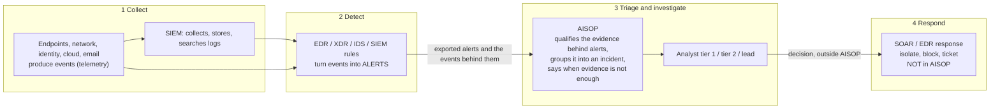

# Where AISOP sits in a SOC, and what each SOC word means here

Written 2026-11-23 from the source. It answers the panel's question: "How do SIEM, EDR, XDR and SOAR differ, how do events, alerts and incidents differ, and where does your tool fit?" Everything about AISOP below was checked against the repository; statements about commercial products are general industry usage, not tested claims.

## 1. The SOC value chain and where AISOP is

AISOP is an **investigation and evidence-qualification layer** between detection and response. It consumes exports of alerts and events; it does not collect at scale, detect, or respond.

## 2. What each tool class is, and whether AISOP is one

| Class | What it does (industry usage) | Is AISOP this? |
|---|---|---|
| SIEM | Collects and stores logs at scale, searches, correlates, raises alerts | **No.** Batch import, one node, no long-term log store |
| EDR | Agent on the endpoint: sees processes, files, network; detects and can isolate | **No.** It reads EDR output; it has no agent |
| XDR | EDR plus identity, email, cloud and network in one detection product | **No** |
| SOAR | Automates response playbooks and ticketing | **No.** No response action exists; export needs lead approval |
| TIP | Holds threat intelligence | **No.** Optional offline TI items are context and never corroborate |
| Case management | Tracks an investigation and its decisions | **Partly yes**: cases, roles, audit, lead review [`models/case.py`, `api/v1/endpoints/cases.py`] |

## 3. The words, and the AISOP object each one becomes

| Word | Meaning | In AISOP | Source |
|---|---|---|---|
| Event / telemetry | One recorded fact, e.g. a process started | A raw record, stored verbatim with its SHA-256, then a canonical event/observation | `correlation/normalize.py`, `evidence_domains/` |
| Alert | A detector's claim that some events matter | A vendor alert normalised to a canonical alert; kept as the vendor's claim, not as proof | `alerts/adapter_protocol.py` and `alerts/adapters/` |
| Observable / IOC | An item seen in events: IP, hash, domain, file | Entities with a link strength: STRONG or SPECIFIC (hash, domain, public IP, path) versus WEAK (host, user, internal IP) | `evidence/independence.py: entity_link_strength` |
| Evidence | Material an investigator can rely on | An independent, observed, hashed record. Duplicates count once; analyst notes, threat intelligence and model output are **never** evidence | `evidence/independence.py`, invariants in `CLAUDE.md` |
| Incident | A group of related evidence describing one story | `Incident`: core clusters joined by strong links, weak context attached but not merged, kill-chain stages, severity | `correlation/models.py: Incident`, `correlation/correlator.py` |
| Investigation | The analyst's work on an incident | A stored investigation result per case, with sufficiency verdict and reason codes | `ai/guardrails/sufficiency_gate.py`, multi-source service |
| Case | The container for the work and who may see it | `Case` with roles lead / analyst / viewer and an audit trail | `models/case.py` |
| Verdict | The decision | AISOP gives **SUFFICIENT / LIMITED / INSUFFICIENT** for the *evidence*, not a verdict on guilt. The analyst decides | `schemas/sufficiency.py` |
| Chain of custody | Proof evidence was not altered | SHA-256 per record plus a hash-chained ledger (tamper-evident since submission) | `correlation/ledger.py` |
| Kill chain / ATT&CK | Stage and technique vocabulary | Stages order the incident; 13 evidence-backed rules map techniques. Model-proposed techniques are never accepted as evidence | `correlation/mitre.py`, `evidence_domains/domain_attack.py` |
| Tier 1 / tier 2 / lead | Analyst levels | Global roles `analyst_tier_1`, `analyst_tier_2`, `security_admin`, plus case-lead approval before export | `core/rbac.py` |

## 4. One incident through the chain (synthetic scenario `01_intrusion_chain`)
1. **Collect:** a workstation logs a PowerShell start, a DNS lookup, an outbound connection, a file write. (events)
2. **Detect:** an EDR and a network IDS each raise an alert about the same host. (alerts, two sources)
3. **AISOP:** ingests both exports, hashes each record, collapses duplicates, links records that share a *specific* artefact (the same domain, public IP, hash) across sources, attaches host/user-only matches as context, orders by kill-chain stage, and asks the gate whether independent evidence supports the story.
4. **Outcome:** SUFFICIENT only when another record from a different source corroborates the key event through a specific shared artefact. Otherwise LIMITED or INSUFFICIENT with reasons, and the model is not called when INSUFFICIENT.
5. **Respond:** the analyst decides; any containment happens in other tools.

## 5. What AISOP does not claim
Detection, response, real-time operation, scale, vendor-validated parsing (sources are synthetic, sample-shaped), or a user-tested workflow. Measured limits are in `docs/12_User_Guides/Panel_Criticism_Validation.md`.

## 6. Sixty-second spoken version
"A SOC collects events, detectors turn some of them into alerts, and analysts investigate alerts and then respond. SIEM stores and searches logs, EDR watches the endpoint, XDR joins several detection sources, and SOAR automates response. AISOP does none of those. It sits between detection and response. It takes the alerts and events they export, keeps every record with a hash, groups the ones that truly belong together, and counts how much independent evidence there is. A shared host or user is context, not corroboration. If the evidence is thin it says so and does not ask the AI. The analyst, not the tool, decides, and nothing leaves without a lead's approval."
