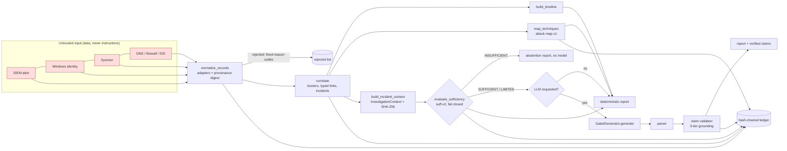
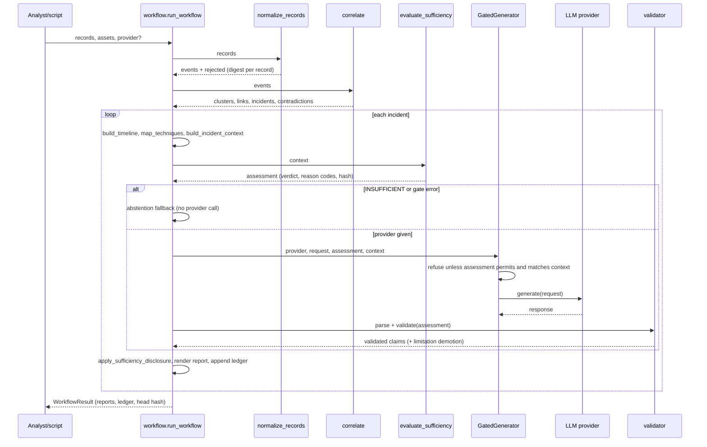

# Multi-Source Investigation Workflow (Stage 3C-R vertical slice)

Status labels: **IMPLEMENTED** = code and passing tests exist in this repository; **PARTIAL** = works with a stated gap; **PROPOSED**, **BLOCKED**, **UNVERIFIED** as defined. This document describes the code that exists on 2026-11-12, not an aspirational design. Decisions: ADR-008 (sufficiency gate) and ADR-009 (correlation and mapping).

## 1. What it does
Given a batch of heterogeneous raw security records (SIEM alert, Windows identity events, Sysmon, DNS and firewall/IDS), it produces for each incident: a provenance-annotated timeline, explainable links, deterministic ATT&CK mappings, an evidence-sufficiency verdict, an optional gated LLM investigation with claim verification, and an analyst report. A hash-chained ledger records every step. The deterministic path needs no LLM (IMPLEMENTED).

## 2. Components and responsibilities
| Component | File | Responsibility | Status |
|---|---|---|---|
| Adapter registry | `backend/app/modules/alerts/adapter_protocol.py` (`get_default_registry`) and `adapters/*.py` | Recognise a raw record and convert it to a `CanonicalAlert` (ADR-007); unchanged | IMPLEMENTED (existing) |
| Normalizer | `backend/app/modules/correlation/normalize.py` (`normalize_records`, `raw_digest`, `normalize_user`) | Raw record to `CorrelationEvent`; provenance digest; identity and entity extraction; asset attribution; rejection codes | IMPLEMENTED |
| Independence primitives | `backend/app/modules/evidence/independence.py` (`cluster_evidence`, `entity_link_strength`, `independent_groups`) | Evidence clusters (duplicates, same record, near-duplicates) and link strength; shared by gate, validator, correlator | IMPLEMENTED |
| Correlator | `backend/app/modules/correlation/correlator.py` (`build_clusters`, `correlate`, `find_contradictions`) | Typed links, incidents, weak attachment, escalation, contradictions | IMPLEMENTED |
| Timeline | `backend/app/modules/correlation/timeline.py` (`build_timeline`) | Ordered entries with stage, membership, duplicates, conflicts | IMPLEMENTED |
| ATT&CK mapper | `backend/app/modules/correlation/mitre.py` (`map_techniques`, `asserted_only_techniques`, `RULES`) | Deterministic technique derivation from evidence | IMPLEMENTED (6 rules) |
| Context builder | `backend/app/modules/correlation/workflow.py` (`build_incident_context`) | Incident to the existing `InvestigationContext` with a real context SHA-256 | IMPLEMENTED |
| Sufficiency gate | `backend/app/modules/ai/guardrails/sufficiency_gate.py` (`evaluate_sufficiency`, `apply_sufficiency_disclosure`) | ADR-008 verdict before any model call; fail closed | IMPLEMENTED |
| Choke point | `backend/app/modules/ai/guardrails/gated_generation.py` (`GatedGenerator.generate`) | Only production caller of `provider.generate` | IMPLEMENTED |
| LLM prompt, parser, validator | `ai/prompt_builder/builder.py`, `ai/response_parser/parser.py`, `ai/guardrails/validator.py` | Existing: prompt, JSON parsing, 3-tier claim grounding; extended with the limitation note and independent-support demotion | IMPLEMENTED |
| Ledger | `backend/app/modules/correlation/ledger.py` (`Ledger`, `verify_chain`) | Hash-chained step record | IMPLEMENTED (not persisted: PARTIAL) |
| Workflow and report | `workflow.py` (`analyze`, `run_workflow`, `workflow_audit_details`), `report.py` (`render_incident_report`, `render_abstention_report`) | Orchestration and analyst-facing Markdown | IMPLEMENTED |
| Demo | `backend/scripts/run_multisource_demo.py`, `correlation/demo_data.py` | Six synthetic scenarios, outputs to a chosen directory | IMPLEMENTED |
| Case/DB integration | `case_service.py`, `investigation_service.py` (ADR-008 gate in both) | Existing case and investigation services use the gate; the new workflow is not yet called by an API route | PARTIAL |

## 3. Data flow and trust boundaries

Trust boundaries: (1) raw records are untrusted; they cross into the system only through adapters and are never interpreted as instructions; (2) everything before the gate is deterministic Python; (3) the model is an optional, untrusted component reached only through `GatedGenerator` and its output is re-validated against the context; (4) the ledger and context hashes make later modification detectable.

## 4. Sequence of one incident (with optional LLM)


## 5. Function-level processing logic
### 5.1 `normalize_records(records, registry=None, assets=None) -> NormalizationResult` (`normalize.py`)
Input: list of dicts or JSON strings; optional IP-to-host map. Steps per record: parse (JSON string allowed); `raw_digest` = SHA-256 of canonical JSON; non-object -> `NOT_AN_OBJECT`; `registry.find_matching_adapter` else `NO_ADAPTER`; `adapter.adapt(obj, raw_ref=digest)`; `_to_event` builds the `CorrelationEvent`: src/dst IP from the network entity or role-tagged IP entities, host from the typed host or host entity (else asset map, labelled), user normalized, domain/process/hashes from typed fields and observables, Sysmon GUIDs and DNS/connection identifiers from the raw `EventData`, Windows logon session (`TargetLogonId`/`LogonId`, host-scoped), outcome (4624 success, 4625 failure, or an explicit `outcome` field), vendor-asserted technique ids, entity set. `event_key = uuid5(digest:index)`. Validation: pydantic frozen models. Side effects: none. Failure: any adapter exception -> `ADAPTER_ERROR:<Type>` (message never recorded); the batch continues. Dependencies: adapter registry, schemas.
### 5.2 `cluster_evidence(items, window)` (`independence.py`)
Union-find over: identical key; identical *attested* digest (missing/zero/malformed digests never merge); identical (identity, content, timestamp); same identity and entity set within 2 s (near-duplicates; different outcomes never merge). Returns key -> cluster id. Deterministic for a given order. Used by `evaluate_sufficiency`, `evidence_clusters_for_context` (validator) and `correlate`.
### 5.3 `correlate(events) -> CorrelationResult` (`correlator.py`)
1. `build_clusters` (evidence clusters, ordered by first seen). 2. For every cluster pair: shared entities; link strength = strongest tier among them (`entity_link_strength`); a link is kept only inside its window (weak 30 min, strong/specific 24 h). 3. Union-find over strong and specific links gives the core components. 4. A component of exactly one cluster with weak links to a multi-cluster component attaches to the component with most weak links as *weak context*; two multi-cluster components joined only weakly stay separate and are listed in `weakly_related`. 5. Incident severity = maximum member severity; stages = ordered distinct kill-chain stages of the core; three or more stages raise severity to at least `high` (`escalated`). 6. `find_contradictions`: same host/user/source address, opposite outcomes within 2 s. Complexity O(n^2) in clusters. Side effects: none.
### 5.4 `map_techniques(events) -> list[MitreMapping]` (`mitre.py`)
De-duplicates by raw digest, then applies `RULES` in order: `MAP-T1110-REPEATED-FAILED-LOGON` (3+ failed Windows logons, one origin, 10 min), `MAP-T1078-SUCCESS-AFTER-FAILURES`, `MAP-T1059.001-POWERSHELL-ENCODED`, `MAP-T1027-ENCODED-COMMAND`, `MAP-T1564.003-POWERSHELL-HIDDEN-WINDOW`, `MAP-T1071-SCRIPT-HOST-OUTBOUND`. Output per mapping: technique, tactics, rule, evidence keys, independent evidence count, `vendor_asserted`, limitation. `asserted_only_techniques` lists source-asserted ids no rule derived. Limitation: heuristics on command-line text; six rules only.
### 5.4b `map_endpoint_techniques(events)` (`mitre_endpoint.py`, table `endpoint-attack-v1`)
Same contract and de-duplication as 5.4 (it calls `map_techniques` with its own table), run next to it in the workflow. 39 rules in two kinds: command-line rules (a named system binary with the technique's defining arguments, source-agnostic) and typed-field rules over Sysmon and Windows Security events using `CorrelationEvent.source_fields` (a fixed whitelist of source fields, 300 characters each, never an entity or link). Each rule states its limitation. Evaluated against third-party labelled captures in `docs/10_Research/Detection_Engineering_Evaluation.md`.
### 5.5 `build_incident_context(result, incident, rejected_count)` (`workflow.py`)
Maps events to `ContextEventItem` (logical event id `logon` for Windows logons, vendor id kept in attributes; canonical event types), entities to `ContextEntityItem`, window = first to last event plus 1 s, deterministic assembly time (last event + 1 h), anchor = earliest event of the highest severity inside the core, at most 200 events (excess recorded as truncation), real `compute_context_sha256`. Rejected-record count is carried as an uncertainty flag.
### 5.6 `evaluate_sufficiency(context)` (`sufficiency_gate.py`, ADR-008 `suff-v2`)
Contradictions; evidence clusters; truncation; temporal consistency; anchor and relevance; provenance; corroboration (different attested cluster + strong/specific link, otherwise `UNCORROBORATED_QUESTION`, with `WEAK_LINK_ONLY` disclosed); required fields for the anchor. Returns an immutable, hashed assessment; any exception yields INSUFFICIENT `GATE_EVALUATION_ERROR`.
### 5.7 `run_workflow(records, assets, provider)` (`workflow.py`)
`analyze` (deterministic) then, if a provider is given, `_llm_for_incident` per incident: abstention fallback when the gate says INSUFFICIENT; otherwise prompt (with the limitation note when LIMITED) -> `GatedGenerator.generate` -> `InvestigationResponseParser.parse` -> `InvestigationOutputValidator.validate(…, assessment)` -> `apply_sufficiency_disclosure`; provider, gate-refusal or parsing failures produce the deterministic fallback and status `fallback:<ExceptionType>`. Ledger steps: NORMALIZE, CORRELATE, SUFFICIENCY, MITRE_MAP, LLM / LLM_GATE, CLAIM_VERIFY, REPORT.
### 5.8 `Ledger`, `verify_chain` (`ledger.py`)
Entry hash = SHA-256(previous hash + canonical JSON of {seq, step, details}); genesis is 64 zeros. `verify_chain` recomputes and returns the first bad index on edit, deletion or reorder.

## 6. Inputs, outputs, validation, side effects
Inputs: raw records (dict or JSON string) and an optional IP-to-host map. Outputs: `WorkflowResult` (normalization result, correlation result, per-incident analysis with Markdown, ledger, head hash, batch abstention report when no incident exists). Validation: frozen pydantic models everywhere; rejection codes for bad records. Side effects: none inside the package; the demo script writes files only to the directory given with `--out`. Dependencies: existing AISOP modules only (no new package).

## 7. Failure handling
Bad record -> rejected with code, batch continues. No usable events -> `NO_EVIDENCE` abstention report, no model. Gate exception -> fail-closed INSUFFICIENT. Provider failure, parse failure or guardrail rejection -> deterministic fallback, status recorded in the ledger and report. Ledger tampering -> `verify_chain` false (the report prints "hash chain verified: NO").

## 8. How the sufficiency, verification and reporting fit together
The verdict is computed from the same context the model would see, before the model. LIMITED adds a fixed note to the prompt, demotes inference claims that cite fewer than two independent evidence clusters, and appends a coded disclosure to the final output's uncertainty list (visible in the report). The report body states the verdict and each reason code in plain language. Claim verification reuses the existing validator (reference existence, information containment, review flagging).

## 9. Known limitations and unimplemented capabilities
- Four adapter source types (SIEM, Windows Security, Sysmon, firewall/IDS) exercised; others (cloud audit, e-mail, Linux auth, EDR) normalize but have no workflow scenario (PARTIAL).
- Six ATT&CK rules; no sub-technique breadth, no rule authoring UI (PROPOSED).
- Wired to the case API and persisted as an audit-row document by Stage 4 (section 10); a dedicated table, background jobs and section-level queries are PROPOSED; PostgreSQL behaviour UNVERIFIED.
- Batch correlation, not streaming; O(n^2) in evidence clusters (IMPLEMENTED limitation).
- No live model was run in these tests; the LLM path is exercised with a scripted provider (UNVERIFIED with a real model).
- Synthetic data only; no accuracy, recall or false-positive measurement of correlation or mapping (UNVERIFIED).
- Research novelty is not claimed; no literature review has been done.

## 10. Integrated flow (Stage 4, ADR-010) - matches the code
```mermaid
sequenceDiagram
  actor A as Analyst (investigator/lead)
  participant UI as MultiSourcePanel
  participant API as cases.py router
  participant S as MultiSourceInvestigationService
  participant DB as case_evidence / raw_evidence
  participant W as correlation.workflow.run_workflow
  participant G as GatedGenerator (optional)
  participant AU as case_audit_events
  A->>UI: Start (explicit click; AI checkbox only with role)
  UI->>API: POST /cases/{id}/investigations/multisource
  API->>API: require_case_role (401/404/403), use_llm role check
  API->>S: start(case_id, actor, use_llm, force)
  S->>DB: load rows linked to THIS case (joinedload raw_evidence)
  S->>S: fingerprint; same as latest and not force -> return stored (200)
  S->>DB: rollback (end read transaction)
  S->>W: records, digests=sha256, event_keys=evidence ids
  W->>W: normalize -> correlate -> timeline -> ATT&CK -> sufficiency
  opt use_llm and verdict is not INSUFFICIENT
    W->>G: generate (fail closed; provider errors -> fallback)
    G-->>W: parsed + claim-verified output, LIMITED disclosed
  end
  W-->>S: incidents, ledger, reports
  S->>DB: re-read; fingerprint changed -> 409 EvidenceChanged
  S->>AU: insert row (details = result); failure -> rollback, 500, no result
  S-->>API: (created, payload)
  API-->>UI: 201 or 200
  UI->>API: GET .../{status|timeline|correlation|attack|sufficiency|report}
  API->>S: get_section (adds stale_evidence)
```
Function map: `cases.py: start_multisource_investigation, get_multisource_investigation_section, _multisource_http_error`; `service: _load_rows, _inputs, fingerprint, _latest, start, get_section, section_view, build_payload, _incident_view, _assessment_view`; `normalize.py: normalize_records(digests, event_keys)`; `workflow.py: analyze, run_workflow`. Failure map: CaseNotFound 404, CaseClosed 409, EvidenceChanged 409, PersistenceFailed 500 (generic), NoInvestigation 404. Tested in `backend/tests/unit/test_multisource_api.py`. Limits: synchronous request, size caps (report 60,000 chars, 200 timeline rows, 100 links), one audit row per run.

## 11. Stage 5 hardening of this workflow
`normalize.py: normalize_records` rejects invalid timestamps, over-deep (32) and over-large (1 MiB) records with fixed codes; `independence.py: is_informative_value / canonical_entity_value` keep placeholder values from becoming specific links; `sufficiency_gate.py: same_observation_class / corroborates` stop repeated observations from corroborating each other (rule version `suff-v3`, new disclosure code `REPEATED_OBSERVATION_ONLY`); `ledger.py: verify_chain(expected_head=)` fails closed and can detect a truncated tail; `workflow.py: MAX_LLM_INCIDENTS = 5`; the service enforces 1,000 evidence rows, caps the stored result and serialises runs per case. See `docs/07_Security/Stage5_Security_Assessment.md` for the defect list and tests.
